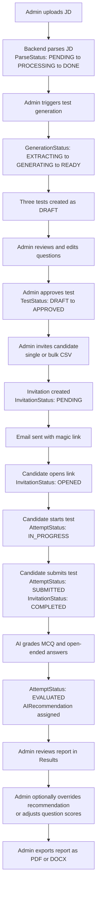
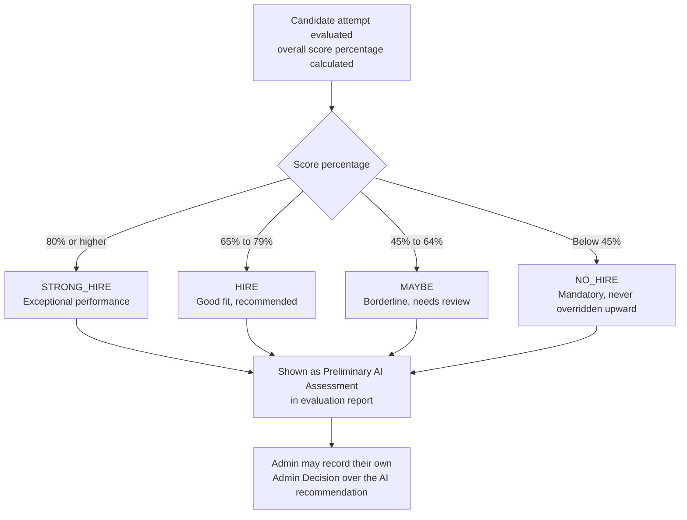
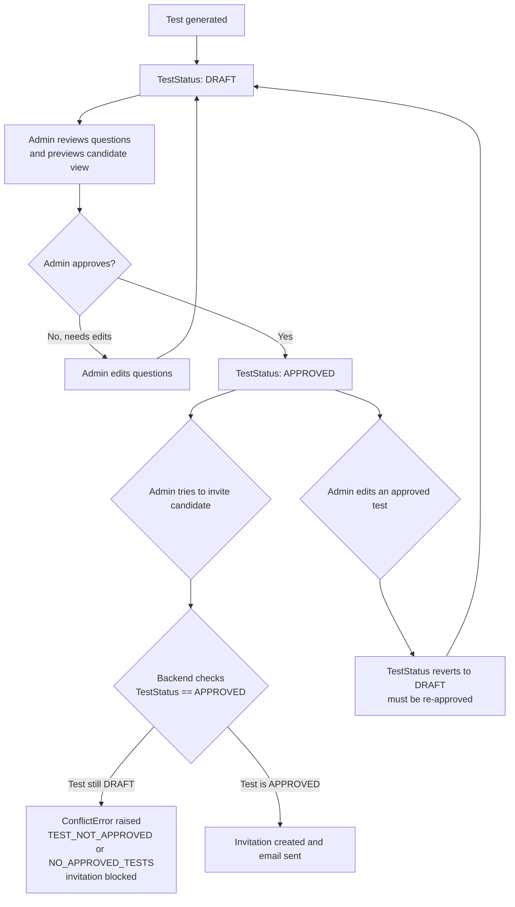
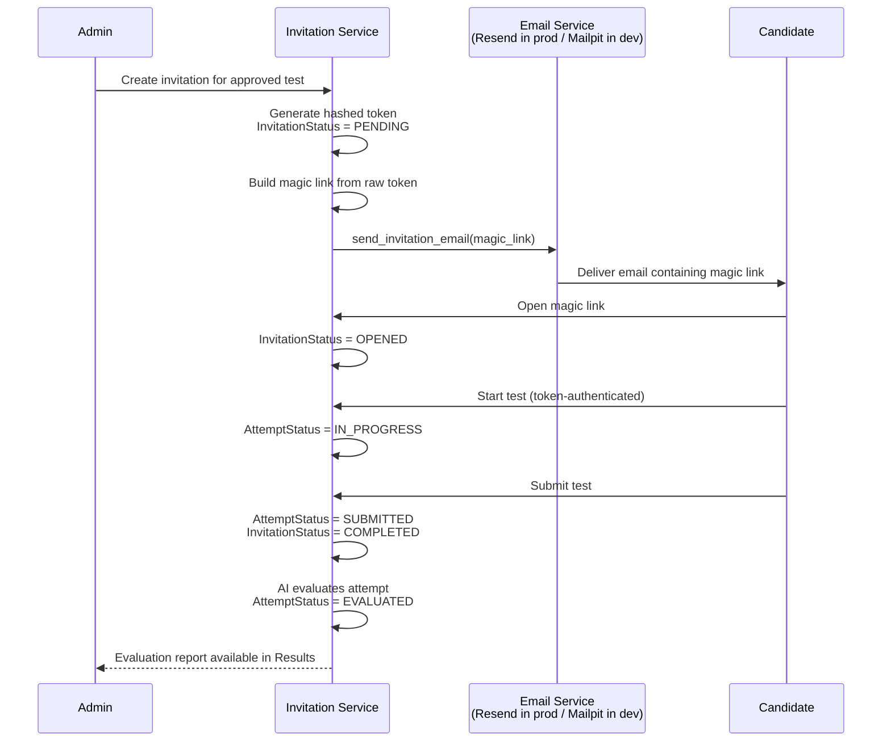

# Talvyn — Product Documentation

> Audience: PMs, business owners, QA, and designers. No code-level knowledge assumed.
> Counts and enumerations in this document are cited from `docs/enterprise/_facts.md`, the
> verified source of truth for this documentation set.

---

## Product Overview

Talvyn is an AI-powered hiring assessment platform. An admin uploads a job description
(JD), and the platform automatically extracts the required skills, generates a full set of
candidate tests from that JD, sends candidates a secure one-click link to take the test, grades
every submission, and produces a structured evaluation report with an AI hiring
recommendation. The admin reviews the report, optionally overrides the AI's verdict, and moves
on to the next candidate.

**The business problem it exists to solve:** technical and competency screening at the top of
a hiring funnel is slow and inconsistent when done by hand. Writing a good screening test for
every open role takes real effort, grading open-ended answers fairly and consistently across
dozens of candidates takes even longer, and the result is often a bottleneck before a candidate
ever reaches a human interviewer. Talvyn compresses that bottleneck: JD upload, test
authoring, candidate delivery, and grading become a few clicks and a wait for a background job,
instead of days of recruiter and hiring-manager effort. The platform is explicit that the AI's
output is a "Preliminary AI Assessment," not a hiring decision — the design intent is to remove
manual drudgery while keeping a human as the final decision-maker.

**Who uses it:** the primary users are HR managers, recruiters, and hiring admins inside an
organization — the people who own a requisition from JD to offer. They are the only users who
log into the platform. The secondary audience is job candidates, who never create an account or
log in at all; they receive a single emailed link, take a timed test through it, and never see
any other part of the system. Everything candidates experience is scoped to that one link.

---

## User Types

### Admin

The codebase defines a `Role` enum with two values, `ADMIN` and `SUPER_ADMIN` (see
`backend/app/db/models/enums.py`). Both are persisted on the `User` model, and `ADMIN` is the
default role assigned to new users (`backend/app/db/models/user.py`). Having checked how the
role is actually consumed elsewhere in the backend, **`SUPER_ADMIN` is not referenced anywhere
outside the enum definition** — no permission check, route guard, or conditional logic in the
codebase treats `SUPER_ADMIN` differently from `ADMIN`. Rather than invent a distinction that
doesn't exist in the product today, this documentation states it plainly: as currently
implemented, **the two roles are functionally identical**. The enum appears to reserve room for
a future tiered-permissions model (e.g., an org owner vs. team admin distinction), but that
model has not been built. Any admin account, regardless of which of the two role values it
holds, has full access to the platform.

**Responsibilities.** The admin owns the entire hiring-assessment lifecycle for a role: sourcing
and uploading the JD, generating and approving tests, inviting and tracking candidates, and
reviewing — and where necessary overriding — the AI's evaluation.

**Permissions.** An authenticated admin can do everything the platform exposes: upload and
manage JDs, trigger AI skill extraction and test generation, edit any question, approve or
archive tests, send single or bulk invitations, revoke invitations, view all candidates and all
results across all JDs, override AI recommendations and individual question scores, and export
reports. There is no concept of a JD or test being private to one admin — any admin account can
see and act on any JD, test, or candidate in the system. There is no read-only or limited-scope
admin variant.

**Available features / UI pages.** Per the verified frontend page inventory in `_facts.md`,
admin-facing pages include: `Dashboard`, `Job Descriptions` (list, upload, detail), JD-scoped
`Candidates`, `Invite Candidate`, and `Tests` (list, detail, and a candidate-facing preview)
pages, a global `Leaderboard`, `Results` (list, per-attempt detail, per-JD results, per-JD
leaderboard, and a printable report view), and `Settings`. All of these sit behind the
`(admin)/dashboard` route group and require an authenticated session.

### Candidate

This is the more important nuance to get right: **"Candidate" is not a logged-in role at all.**
There is no candidate login screen, no candidate password, and no candidate account in the
authentication sense. The `Candidate` database model itself (`backend/app/db/models/candidate.py`)
stores only `email`, `name`, an optional `phone`, and optional `linkedin_url`/`resume_url`
(the latter two only ever populated by the public self-registration form, not the admin
invite form) — there is no credential field on it. A candidate's only relationship to the
system is through an `Invitation` record: a per-test, single-use, hashed token that is
emailed to them as a "magic link," or minted on the spot if they arrived via a public
assessment link instead of a direct admin invite. Possessing that link's token
*is* the candidate's entire identity and authorization for the system — verified per-request via
an `X-Attempt-Token` mechanism (`_load_attempt_for_token` in `attempt_service.py`), not a user
session. If a candidate loses the email or the link expires, they have no account to recover —
an admin must issue a new invitation (or, for a public-link candidate, simply revisiting
`/apply/<slug>` and re-registering with the same email mints a fresh token for their existing
invitation, provided it hasn't already been completed).

**Responsibilities.** Open the link they were emailed, complete the assigned test(s) within the
allotted time, and submit.

**Permissions.** A candidate, via their token, can only ever see and act on the one test attempt
tied to that token. They cannot see other candidates, other tests, any admin page, or any data
outside their own attempt. They cannot retake a test once submitted — submission is final and
single-use per the existing user guide. They have no visibility into their own score or the AI
recommendation; results are admin-only.

**Available features / UI pages.** The candidate-facing pages, per the frontend inventory, are
all outside the admin route group: `test/[token]` (landing/start page for the link), `test/[token]/exam`
(the timed test itself), `test/complete` (post-submission confirmation), and `test/expired`
(shown when a link is no longer valid). The candidate experience includes a visible countdown
timer, autosave of answers every few seconds, and a single, final submission — all described
consistently in `docs/user-guide.md`.

---

## Business Workflows

### End-to-end user journey (JD upload through candidate report review)

1. **Upload.** An admin uploads a JD as a PDF or DOCX from the **Job Descriptions** page.
2. **Parse.** The backend parses the document; while this runs, the JD's `ParseStatus` moves
   `PENDING → PROCESSING → DONE` (or `FAILED` if parsing breaks).
3. **Skill extraction & generation.** The admin triggers test generation. A `GenerationStatus`
   tracks this in the background: `IDLE → EXTRACTING → GENERATING → READY` (or `FAILED`). Per
   the user guide, this produces three tests — Technical Screening, Practical Reasoning, and
   Role-Specific Problem Solving — each a mix of auto-graded multiple-choice and AI-graded
   open-ended questions. Generation runs as a background job and can take several minutes; the
   admin can navigate away and return.
4. **Review & approve.** Every generated test starts in `TestStatus.DRAFT`. The admin reviews
   and can edit questions, preview the exact candidate-facing experience (with an optional
   answer-key overlay), and then approves the test, moving it to `TestStatus.APPROVED`. This
   step is a hard gate, not just UI guidance (see Approval flow below).
5. **Invite.** From the JD page, the admin invites candidates one at a time, via CSV bulk
   upload (up to 50 per batch per the user guide), or by creating one **public assessment
   link** (`/apply/<slug>`) to share broadly on a job board or careers page — selecting which
   approved test(s) to assign. Either way, every individual candidate ends up with their own
   single-use, hashed token and an `InvitationStatus` of `PENDING`; the public link itself
   never doubles as a candidate's token — it only identifies the assessment, and each visitor
   who registers through it mints their own separate invitation.
6. **Candidate takes the test.** A directly-invited candidate receives an email with a magic
   link; a candidate arriving via the public link instead enters their name and email on the
   `/apply/<slug>` page, which the backend turns into the same kind of private invitation
   before redirecting them into the test flow. From here both paths converge: opening the
   private link moves the invitation to `OPENED`; starting the attempt moves `AttemptStatus`
   from `NOT_STARTED` to `IN_PROGRESS`. Answers autosave continuously. Submitting moves the
   attempt to `SUBMITTED` and the invitation to `COMPLETED`.
7. **Evaluation.** The platform grades MCQs instantly and uses AI to grade open-ended answers,
   producing an overall score and an `AIRecommendation`. The attempt moves to `AttemptStatus.EVALUATED`.
8. **Report review.** The admin opens the **Results** pages to read the AI summary, strengths,
   weaknesses, and per-question feedback, and may record an admin override decision or adjust
   individual question scores before exporting the report (print/PDF or DOCX).

### Decision flow — AI recommendation logic

Verified directly in `backend/app/services/evaluation_service.py`, both in the prompt
instructions given to the model (`_AGG_SYSTEM_PROMPT`) and in a deterministic enforcement
function, `_score_to_recommendation()`, that maps a percentage to a tier in code — meaning the
final recommendation is not left purely to the LLM's discretion; the code clamps it to these
exact bands:

| Recommendation | Score | Meaning |
|---|---|---|
| `STRONG_HIRE` | ≥ 80% | Exceptional performance, strongly recommended |
| `HIRE` | 65–79% | Good fit, recommended |
| `MAYBE` | 45–64% | Borderline, worth a closer look |
| `NO_HIRE` | < 45% | Significant gaps; the prompt explicitly marks this **mandatory, never to be overridden upward** |

This matches what `docs/user-guide.md` already tells admins, so the existing user-facing
documentation is accurate on this point.

### Approval flow — draft tests cannot be sent to candidates

Verified in `backend/app/services/invitation_service.py`: invitation creation explicitly checks
the test's status before proceeding. For a single named test, the code raises a `ConflictError`
(`error_code="TEST_NOT_APPROVED"`) if `test.status != TestStatus.APPROVED`. For the "all approved
tests" path used when an admin doesn't pick a specific test, the service filters strictly on
`Test.status == TestStatus.APPROVED` and raises a separate `ConflictError`
(`error_code="NO_APPROVED_TESTS"`) if none qualify. In other words, this is a real, enforced
backend gate — not just a UI affordance — so there is no route by which a candidate can receive
a draft test. Editing an approved test reverts it to `DRAFT`, requiring re-approval before it can
be used in any new invitation, which matches the FAQ in `docs/user-guide.md`.

### Notification flow — invitation emails

Verified in `backend/app/services/email_service.py`: sending the invitation email is triggered
directly from `invitation_service.py` immediately after an invitation (or a resend) is created,
once a magic link has been built from the invitation's raw token. The service chooses its
transport based on configuration rather than a hardcoded environment check: if an SMTP host is
configured it sends via SMTP (this is how **Mailpit** is used in development, and how any
generic SMTP relay could be used in staging); otherwise it sends via the **Resend** HTTP API,
which is the production path, guarded by a real (non-placeholder) Resend API key. The email
itself — confirmed in code, not assumed — contains a magic link URL built from the candidate's
unique token (e.g. `https://app.example.com/test/<token>`), rendered in both the HTML body and a
plain-text fallback. No password or account-creation step is ever part of this email; the link
alone is the candidate's access credential, consistent with the "no candidate account" model
described above.

---

## Mermaid Diagrams

### 1. End-to-end user journey (admin + candidate combined)

### 2. Decision flow — score percentage to AI recommendation

### 3. Approval flow — draft to approved before invitations are allowed

### 4. Notification flow — invitation created to candidate opens to status updates

---

## Notes on what was verified vs. what is documented elsewhere

- The `SUPER_ADMIN` vs `ADMIN` distinction is explicitly reported above as **non-existent in
  current code**, rather than invented, per direct inspection of every reference to `Role` in
  the backend.
- The AI recommendation thresholds, the test-approval gate before invitations, and the
  Resend/Mailpit notification behavior were each confirmed by reading the relevant service code
  (`evaluation_service.py`, `invitation_service.py`, `email_service.py`) rather than assumed from
  the user guide, though in every case the result matches what `docs/user-guide.md` already
  tells admins.
- Page names and counts are cited from the verified inventory in `docs/enterprise/_facts.md`
  rather than re-derived.
