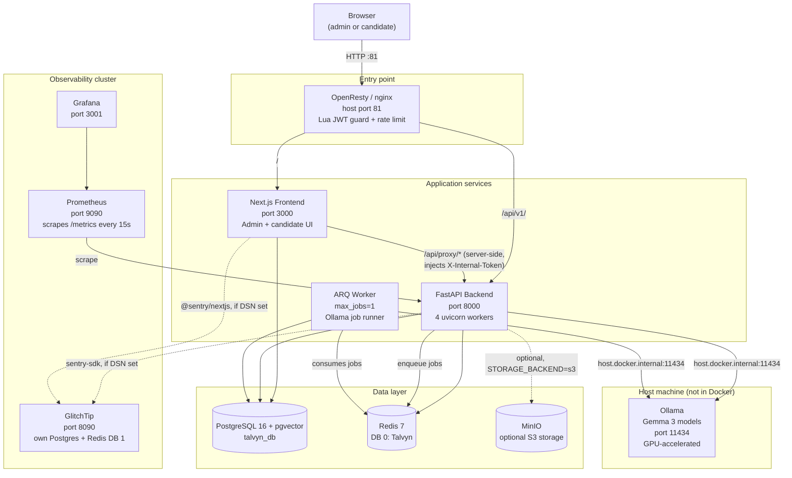
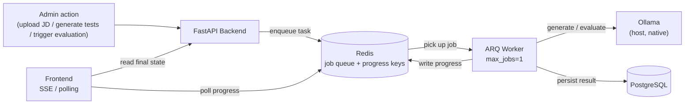

# System Architecture

> This document gives a structural, at-a-glance view of how Talvyn is built
> and deployed. For the narrative explanation of **why** each of the 14 Docker
> services exists, read [`docs/architecture.md`](../architecture.md) — in
> particular its
> [Service Inventory](../architecture.md#service-inventory--why-each-container-exists-and-what-it-does)
> section, which this document deliberately does not re-explain. All counts
> below are sourced from [`_facts.md`](./_facts.md); see that file for the
> verification method behind each number.

---

## High-Level Architecture

Talvyn runs as 14 Docker Compose services (`_facts.md` §8) plus one
native, non-containerized process (Ollama). Browser traffic enters through a
single OpenResty/nginx reverse proxy, which fronts the Next.js frontend and
FastAPI backend. Background AI work is offloaded from the request path to a
dedicated ARQ worker process via Redis. Observability (Prometheus + Grafana)
and error tracking (GlitchTip) run as a separate cluster alongside the core
application services.

> **Port note:** `docker-compose.yml` maps nginx to host port **81**, not the
> conventional 80 (port 80 is commented out in the compose file to avoid
> clashing with other services on some hosts). See `_facts.md` §13 for the
> three different, currently-inconsistent descriptions of "how to run
> Talvyn in production" (`docker-compose.yml` vs. `docker-compose.prod.yml`
> vs. `deploy-ngrok.sh`) — that drift is flagged, not resolved, here.

Two request-routing paths worth calling out explicitly (full detail in
`docs/architecture.md#request-routing`):

- **Admin requests** go through the Lua JWT structural check at the nginx
  layer, then to either the frontend directly or to the backend via the
  Next.js server-side proxy (which injects `X-Internal-Token`).
- **Candidate requests** (`/api/v1/attempts/*`, `/api/v1/invitations/*`) are
  exempted from the Lua cookie check and instead authenticate with their own
  per-attempt token — see [Auth Model](#auth-model) below.

### Background job flow

---

## Tech Stack by Layer

### Frontend

| Aspect | Detail |
| --- | --- |
| Framework | Next.js **15.1.3**, App Router (file-based routing under `frontend/src/app/`) |
| UI runtime | React 19.0.0 / React DOM 19.0.0 |
| Auth | NextAuth 4.24.11 (credentials provider, JWT session, httpOnly cookie) |
| ORM (frontend-owned tables) | Prisma 6.1.0 (`@prisma/client`) — admin/NextAuth tables only |
| HTTP client | axios 1.7.9 (native `fetch()` used specifically for SSE — axios buffers the full response, which would break streaming) |
| Validation | zod 3.24.1 |
| Styling | Tailwind CSS 3.4.17 |
| Icons | lucide-react |
| Password hashing | bcryptjs |
| Error tracking | @sentry/nextjs 8.0.0 (gated on `NEXT_PUBLIC_GLITCHTIP_DSN`) |
| State management | **No Redux/Zustand/MobX.** One React Context provider (`GenerationContext.tsx` in `frontend/src/contexts/`) plus plain hooks: `useAutoSave.ts`, `useSuspiciousEvents.ts`, `useTestTimer.ts` (`frontend/src/hooks/`) — 3 total, per `_facts.md` §5. Server state otherwise lives in React Server Components / server-side data fetching, not a client store. |
| Type checking / lint | TypeScript 5.7.2, ESLint 9 + `eslint-config-next` |
| Build tool | Turbopack (`next dev --turbopack`) for dev; standard `next build` for production |
| Native parsing | `frontend/wasm-parser` — Rust compiled to WebAssembly (`pdf-extract`, `zip`+`quick-xml`) for client-side PDF/DOCX text extraction before falling back to server-side parsing |

### Backend

| Aspect | Detail |
| --- | --- |
| Framework | FastAPI 0.115.6 |
| Runtime | Python 3.12 (`python:3.12-slim` base image) |
| ASGI server | Uvicorn 0.32.1, 4 workers |
| ORM | SQLAlchemy 2.0.36, **async** (`sqlalchemy[asyncio]`) |
| Migrations | Alembic 1.14.0 — 5 migrations applied in order (`_facts.md` §9); `prestart.sh` runs `alembic upgrade head` before uvicorn starts |
| Validation | Pydantic 2.10.3 / pydantic-settings 2.6.1 |
| Background jobs | ARQ 0.26.1 (Redis-backed queue, separate worker process, `max_jobs=1`) |
| Rate limiting | slowapi, Redis-backed, shared across all 4 uvicorn workers |
| Error tracking | sentry-sdk[fastapi] 2.19.2 (gated on `GLITCHTIP_DSN`) |
| Metrics | prometheus-fastapi-instrumentator 7.0.0, exposed at `/metrics` |
| **Auth model** | **Dual-token, no shared-session auth between frontend and backend.** See [Auth Model](#auth-model) below. |

#### Auth model

Talvyn's backend does not use NextAuth sessions directly — it uses two
independent, purpose-built tokens, defined in `backend/app/dependencies.py`
and `backend/app/api/v1/attempts.py`:

- **`X-Internal-Token` (`VerifiedInternal`)** — a shared secret
  (`INTERNAL_API_SECRET`) sent only by the Next.js server (never the
  browser). Verified with `hmac.compare_digest` over SHA-256 digests
  (constant-time, timing-attack resistant) in `verify_internal_token()`.
  This is **not** end-user authentication — it's a trust boundary asserting
  "this request came from our own Next.js server," which is what actually
  enforces the admin session (NextAuth JWT, checked earlier by `getToken()`
  in the Next.js proxy and by the nginx Lua guard).
- **`X-Attempt-Token` (`AttemptToken`)** — used exclusively by candidate
  attempt endpoints (`/api/v1/attempts/*`), which the candidate browser
  calls *directly*, with no Next.js server in between. Every mutating
  endpoint (`save_answer`, `bulk_save_answers`, `heartbeat`,
  `submit_attempt`, `log_suspicious_event`, `get_attempt_state`) calls
  `_load_attempt_for_token()` as its first operation, validating the
  token against the specific `attempt_id` in the path. `POST
  /attempts/start` is the one public exception — it validates the
  invitation's magic-link token instead, per `_facts.md` §1's auth-exemption
  list.

This split exists because the two callers have different trust levels: the
Next.js server is a known, secret-holding backend process, while the
candidate browser is anonymous and should only act on the one attempt it was
issued a token for. See `docs/architecture.md#auth-architecture` for the full
login/magic-link sequence diagrams.

### Database

| Aspect | Detail |
| --- | --- |
| Engine | PostgreSQL 16, image `pgvector/pgvector:pg16` |
| Vector extension | pgvector — `evaluations.embedding vector(768)` with an HNSW cosine-similarity index, added in migration `db7cdbbfd2a8` (`_facts.md` §9) |
| Tables | 12 (`_facts.md` §2) |
| Enums | 12, all in `backend/app/db/models/enums.py` (`_facts.md` §3) |
| Schema ownership | Alembic owns all schema changes for the application schema; Prisma (frontend) manages only its own admin/NextAuth tables against the same Postgres instance |
| Schema design philosophy | Briefly: one JD fans out into extracted skill data, generated tests/questions, invitations, and per-candidate attempts/answers/evaluations — a single linear hierarchy rather than a normalized many-to-many web. Full ER diagram, column-level detail, and design rationale are out of scope here — see the forthcoming `06-database-documentation.md`. |

### Infrastructure

| Aspect | Detail |
| --- | --- |
| Hosting model | Self-hosted via Docker Compose — not a cloud-managed stack (no RDS, no managed Redis, no managed k8s). All state lives in named Docker volumes on one host. |
| Container count | **14 services** (`_facts.md` §8): `postgres`, `redis`, `mailpit`, `backend`, `worker`, `frontend`, `nginx`, `minio`, `glitchtip-db`, `glitchtip-migrate`, `glitchtip`, `glitchtip-worker`, `prometheus`, `grafana`. Rationale for each is covered in `docs/architecture.md`'s Service Inventory — not repeated here. |
| Reverse proxy | OpenResty (`openresty/openresty:alpine`) — nginx + embedded LuaJIT, running `nginx/lua/jwt_check.lua` for a structural JWT pre-check ahead of FastAPI |
| CI/CD | `.github/workflows/ci.yml` — two jobs on push/PR to `main`: `backend-tests` (Python 3.12, pytest against in-memory SQLite, 213 tests across 11 files) and `frontend-checks` (Node 20, Prisma generate, lint, type-check, build). **Be honest about the gap:** there is no E2E job, no deployment job, no migration-against-Postgres check, and no frontend test execution (0 frontend tests exist — no Jest/Vitest/Playwright/Cypress config anywhere in `frontend/`). CI verifies the code builds and the backend's unit-level logic passes; it does not verify a deployable artifact or a real-Postgres migration path. |
| Deployment scripts | Three different, mutually inconsistent topologies exist (`docker-compose.yml`, `docker-compose.prod.yml`, `deploy-ngrok.sh`) — see `_facts.md` §13. Not resolved here; flagged for `09-devops-documentation.md`. |

### AI Layer

| Aspect | Detail |
| --- | --- |
| LLM provider | **Self-hosted Ollama**, not an external API (no OpenAI/Anthropic/etc. call in the hot path). Practical consequence: no per-token billing, and no JD text, candidate answers, or evaluation content ever leaves the host machine. |
| Models | Gemma 3, size selected per detected hardware profile by `start.sh` (6 profiles: `ultra` → `gemma3:27b` on ≥16 GB VRAM, `high` → `gemma3:12b` on ≥8 GB, `medium` → `gemma3:4b` on ≥4 GB, `low` → `gemma3:1b` on ≥2 GB, `cpu_fast` → `gemma3:4b` on ≥16 GB RAM with no GPU, `cpu_slow` → `gemma3:1b` otherwise). Profile also tunes `OLLAMA_NUM_PARALLEL`, thread count, generation timeout, and question counts per test. Written to the gitignored `backend/.env.hardware` (`_facts.md` §10). |
| Embeddings | `nomic-embed-text`, 768-dim, **opt-in** via `EMBEDDING_ENABLED` (default `false`). Best-effort only — any failure (model not pulled, Ollama unreachable, malformed response) leaves `Evaluation.embedding` as `NULL` rather than failing the evaluation pipeline. |
| Vector store | **No separate vector database.** Embeddings live in the `evaluations.embedding` pgvector column on the same Postgres instance used for everything else — one less moving part, one less service to operate. |
| Hosting | Runs natively on the host (not in Docker) for direct, unmediated GPU access — see `docs/architecture.md#why-ollama-runs-natively-not-in-docker`. Reached by backend/worker via `host.docker.internal:11434`. |
| Output discipline | Every Ollama call uses `"format": "json"` + `temperature: 0.1` + fixed seeds, with Pydantic validation and up to 3 correction-prompt retries before raising — see `docs/architecture.md#ai-prompt-strategy` for the full retry diagram. |

---

## Where to Go Next

- **Why each service exists, request routing, full data-flow pipelines, Redis
  key space, file storage, design-decision rationale, auth sequence
  diagrams, AI prompt strategy, performance numbers** — all covered in depth
  in [`docs/architecture.md`](../architecture.md). This document is a
  structural companion to that one, not a replacement.
- **Database schema detail** (ER diagram, column types, the
  `calculate_evaluation_scores` PL/pgSQL function, migration history) —
  `06-database-documentation.md` (forthcoming).
- **Deployment topology drift between `docker-compose.yml`,
  `docker-compose.prod.yml`, and `deploy-ngrok.sh`** —
  `09-devops-documentation.md` (forthcoming).
- **Authoritative counts and enumerations** used throughout this document —
  [`_facts.md`](./_facts.md).
