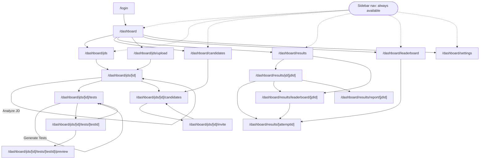
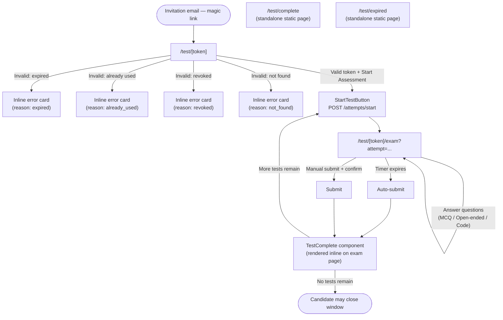

# Frontend Documentation — Talvyn

> Audience: frontend developers, QA engineers, designers.
> Stack: Next.js 15 (App Router), React, TypeScript, Tailwind CSS, NextAuth (credentials provider), Zod, `clsx`, `lucide-react` icons.
> Source of truth for counts: `docs/enterprise/_facts.md` plus a fresh re-run of `find` against this repository on 2026-06-18 (see note below — the actual counts differ slightly from the facts file's hand-typed lists, which the facts file itself warned could happen).

**Verified counts (via `find frontend/src/app -name "page.tsx"` and `find frontend/src/components -name "*.tsx"`):**
- **23** `page.tsx` files (the facts file's hand-typed list said "21" but listed 22 paths and explicitly flagged this as unreliable — direct `find` returns 23).
- **33** component files under `frontend/src/components/` (matches the facts file).
- **12** route-level boilerplate files (`loading.tsx` / `error.tsx` / `not-found.tsx`) — the facts file said "11 confirmed by find" but a fresh count returns 12; this document uses the fresh count.
- **3** custom hooks, **1** context provider — both match the facts file.
- **3** `layout.tsx` files: root (`app/layout.tsx`), admin shell (`app/(admin)/layout.tsx`), candidate test shell (`app/test/layout.tsx`). There is no separate `(admin)/dashboard/layout.tsx` — the admin shell lives one level up, in `(admin)/layout.tsx`.

---

## 1. Routing & Layout Architecture

The app uses three route groups / shells:

| Shell | File | Auth | Purpose |
|---|---|---|---|
| Root | `frontend/src/app/layout.tsx` | none | HTML shell, fonts, global metadata |
| Admin | `frontend/src/app/(admin)/layout.tsx` | NextAuth session required (`redirect("/login")` if absent) | Wraps every `/dashboard/*` page with `SessionProvider` → `GenerationProvider` → `AdminShell` (sidebar, header, notification bell, generation banner) |
| Candidate test | `frontend/src/app/test/layout.tsx` | **none — intentionally unauthenticated** | Minimal header, no sidebar. Each page underneath independently validates the magic-link token server-side before rendering content |

The `(admin)` route group has no layout-level loading/error boundary of its own at the `dashboard` segment specifically — boilerplate files are scattered at various nested segments (see §3).

---

## 2. Pages

### 2.1 Landing

#### `/` — `frontend/src/app/page.tsx`
- **Purpose**: Public marketing/landing page for Talvyn.
- **Route**: `/` (root, no route group).
- **Type**: Server component (no `"use client"`), fully static — no data fetching.
- **Components used**: `LandingNav` (`@/components/landing/LandingNav`), `AnimatedSection` (`@/components/AnimatedSection`). All other sections (`Hero`, `DashboardMockup`, `TrustedBy`, `Stats`, `HowItWorks`, `TestTypes`, `Features`, `Comparison`, `Testimonials`, `FinalCTA`, `Footer`) are private functions defined in-file, not shared components.
- **API calls**: none.
- **State management**: none — pure presentational server component. All interactivity (mobile nav toggle, scroll-reveal) is delegated to the two client components it imports.
- **User actions**: "Start for free" / "Get started" CTAs link to `/login`; anchor links scroll to in-page sections (`#how-it-works`, `#features`, `#test-types`, `#testimonials`).
- **Error handling / loading states**: none applicable (static content).
- **Key dependencies**: `lucide-react` icons, Tailwind utility classes, CSS animation classes (`animate-page-enter`, `animate-float`, `animate-glow-pulse`) defined elsewhere in the global stylesheet.
- **Notable detail**: the `DashboardMockup` sub-component renders a fake, hard-coded leaderboard screenshot purely for hero-image decoration — it is not live data.

### 2.2 Auth

#### `/login` — `frontend/src/app/(auth)/login/page.tsx`
- **Purpose**: Admin sign-in page using NextAuth credentials provider.
- **Route**: `/login` (inside the `(auth)` route group, which has no shared layout file of its own beyond the root).
- **Type**: Client component (`"use client"`). The exported default `LoginPage` wraps the actual form (`LoginForm`) in `<Suspense>` with a `LoginShell` fallback, because `LoginForm` calls `useSearchParams()` which requires a Suspense boundary in the App Router.
- **Components used**: `Input`, `Button` (both from `@/components/ui/`).
- **API calls**: `signIn("credentials", { email, password, redirect: false })` from `next-auth/react` — not a direct REST call but NextAuth's client API, which itself calls NextAuth's internal `/api/auth/callback/credentials` route.
- **State management**: local `useState` for `email`, `password`, field `errors`, `authError`, and `loading`.
- **Validation**: client-side Zod schema (`loginSchema`) validates email format and non-empty password before calling `signIn`.
- **User actions**: submit the form to sign in; on success, `router.push(callbackUrl)` (defaults to `/dashboard`, or whatever `callbackUrl` query param NextAuth supplied) followed by `router.refresh()`.
- **Error handling**: Zod validation errors are mapped per-field; failed `signIn` shows a generic "Incorrect email or password" banner (the backend doesn't leak which field was wrong).
- **Loading state**: `Button`'s `loading` prop disables the button and shows a spinner during submission; the Suspense fallback (`LoginShell` with a centered `Loader2` spinner) covers the brief moment before `LoginForm` hydrates.

### 2.3 Admin Dashboard

#### `/dashboard` — `frontend/src/app/(admin)/dashboard/page.tsx`
- **Purpose**: Landing page for the admin area — overview stats + quick-action shortcuts.
- **Type**: Async server component. `export const revalidate = 0` (always fetch fresh — stats change on every generation/evaluation).
- **API calls**: `serverFetch<DashboardStats>("/api/v1/stats/", { cache: "no-store" })` — fetches `jd_count`, `test_count`, `invitation_count`, `evaluation_count`.
- **Components used**: none beyond `Link` and inline-rendered stat/quick-action cards (no extracted sub-components).
- **User actions**: click any stat card or quick-action card to navigate to the relevant section (`/dashboard/jds`, `/dashboard/candidates`, `/dashboard/results`, `/dashboard/jds/upload`).
- **Error handling**: if `serverFetch` returns `null` (failure), each stat falls back to `0` via `stats?.jd_count ?? 0` — no error banner, graceful degradation.
- **Loading state**: none client-visible — this is a server-rendered page, so Next.js shows the route's `loading.tsx` (none exists at this exact segment) during the fetch; in practice the dashboard segment has no dedicated `loading.tsx`, so Next.js falls back to the nearest ancestor boundary or a blank transition.

#### `/dashboard/jds` — `frontend/src/app/(admin)/dashboard/jds/page.tsx`
- **Purpose**: List all uploaded job descriptions.
- **Type**: Async server component, `revalidate = 0`.
- **API calls**: `serverFetch<JobDescriptionListResponse>("/api/v1/jd/?page=1&page_size=50")`.
- **Components used**: `JdStatusBadge`, `Button` (with `Plus` icon to link to upload page).
- **User actions**: "Upload JD" button/link; click a JD row to go to `/dashboard/jds/[id]`.
- **Empty state**: dedicated empty-state card with icon, copy, and an "Upload your first JD" CTA when `data.items.length === 0`.
- **Error handling**: if `serverFetch` fails (`null`), same empty-state UI is shown (no distinction between "no JDs" and "fetch failed" — a minor UX gap worth noting for QA).
- **Loading state**: dedicated `loading.tsx` exists at this segment (`(admin)/dashboard/jds/loading.tsx`).

#### `/dashboard/jds/upload` — `frontend/src/app/(admin)/dashboard/jds/upload/page.tsx`
- **Purpose**: Upload a new JD (PDF/DOCX).
- **Type**: Static server component (no data fetching) — just renders instructional copy ("What happens after upload" step list) plus the upload form.
- **Components used**: `JdUploadForm` (the actual upload logic lives entirely in that client component).
- **API calls**: none directly on this page — delegated to `JdUploadForm`.
- **No loading.tsx exists** at this exact segment.

#### `/dashboard/jds/[id]` — `frontend/src/app/(admin)/dashboard/jds/[id]/page.tsx`
- **Purpose**: JD detail page — shows parse status, extracted skills/structure, raw text preview, and links onward to Tests/Candidates.
- **Type**: Async server component. Uses React's `cache()` to deduplicate the JD fetch between `generateMetadata()` and the page body — both call `getJd(id)`, and without `cache()` that would be two backend round-trips per page load. The fetch itself uses `cache: "no-store"` (not Next's Data Cache) because `AnalyzeJdButton`'s `router.refresh()` only invalidates the Router Cache, not the Data Cache — so server-side caching here would serve stale pre-analysis data for up to the revalidate window even after a refresh.
- **API calls**: `serverFetch<JobDescription>(`/api/v1/jd/${id}?include_raw_text=true`)`.
- **Components used**: `JdStatusBadge`, `Badge`, `SkillsPanel`, `AnalyzeJdButton`.
- **Conditional UI states**: pending/processing (extraction in progress), failed (extraction failed, prompts re-upload), parsed-but-not-analyzed (prompts clicking "Analyze JD"), and fully analyzed (renders `SkillsPanel` + a collapsible raw-text `
` block capped at 5,000 characters with a "+N more characters" hint).
- **User actions**: trigger/re-trigger analysis via `AnalyzeJdButton`; navigate to Tests or Candidates via two "next step" cards.
- **404 handling**: calls Next's `notFound()` if the JD doesn't exist.
- **Loading state**: dedicated `loading.tsx` exists (`(admin)/dashboard/jds/[id]/loading.tsx`).

#### `/dashboard/jds/[id]/candidates` — `frontend/src/app/(admin)/dashboard/jds/[id]/candidates/page.tsx`
- **Purpose**: Manage invitations for one specific JD — view status, resend, revoke, re-invite.
- **Type**: Client component (`"use client"`) — entirely client-rendered, no server data fetch on initial render (data loads via `useEffect`).
- **State management**: `useState` for `data` (invitation list), `loading`, `actionLoading` (per-row spinner), `error`, and `pendingMagicLink` (shown when a resend succeeds but email delivery fails).
- **API calls**: `invitationsApi.listForJd(jdId)` on mount via `useCallback`-wrapped `load()`; `invitationsApi.resend(invitationId)`; `invitationsApi.revoke(invitationId)`.
- **Components used**: `InvitationStatusBadge`, `Button`. A private `MagicLinkBanner` sub-component (defined above the page component to dodge a Turbopack forward-reference issue) renders a copyable magic link when email delivery fails on resend.
- **User actions**: resend invitation (allowed for `PENDING`/`OPENED`/`EXPIRED`), revoke (allowed for `PENDING`/`OPENED`, confirmed via native `confirm()`), re-invite (only for `REVOKED` — links to the invite page since `REVOKED` isn't blocked by `_find_active_invitation` on the backend), view results (`COMPLETED` with an `attempt_id`).
- **Error handling**: maps backend error codes `INVITATION_REVOKED` / `INVITATION_COMPLETED` to specific human-readable messages; generic fallback otherwise. Dismissible error banner.
- **Loading states**: full-page `Loader2` spinner while `loading` is true; per-row spinner via `actionLoading` during resend/revoke.

#### `/dashboard/jds/[id]/invite` — `frontend/src/app/(admin)/dashboard/jds/[id]/invite/page.tsx`
- **Purpose**: Entry point for inviting a candidate (single or bulk) to take an approved test for this JD.
- **Type**: Async server component, `revalidate = 0` (approval status must always be fresh — a stale "approved" list could hide a just-archived test).
- **API calls**: `Promise.all([serverFetch(jd), serverFetch(tests for jd)])` — fired concurrently since independent.
- **Components used**: `InviteModeSwitcher` (which itself renders `InviteForm` or `BulkInviteForm`).
- **Conditional UI**: warning banner if there are zero approved tests, with a link to the Tests page.
- **404 handling**: `notFound()` if the JD doesn't exist.
- **Loading state**: dedicated `loading.tsx` exists.

#### `/dashboard/jds/[id]/tests` — `frontend/src/app/(admin)/dashboard/jds/[id]/tests/page.tsx`
- **Purpose**: List the (up to 3) generated tests for a JD; entry point for triggering generation.
- **Type**: Async server component, `revalidate = 0`.
- **API calls**: `Promise.all([serverFetch(jd), serverFetch(tests for jd)])`.
- **Components used**: `TestCard` (one per test), `GenerateTestsButton`.
- **Conditional UI**: warning if skills haven't been extracted yet (must run "Analyze JD" first); empty state if extracted but no tests yet; approval reminder footer if some tests remain unapproved.
- **404 handling**: `notFound()` if JD missing.
- **Loading state**: dedicated `loading.tsx` exists.

#### `/dashboard/jds/[id]/tests/[testId]` — `frontend/src/app/(admin)/dashboard/jds/[id]/tests/[testId]/page.tsx`
- **Purpose**: Full test review/edit page — metadata, approve/revert, regenerate, per-question editing.
- **Type**: Async server component using `cache()` to dedupe the test fetch across `generateMetadata()` and the page body (`revalidate: 30` on the underlying fetch).
- **API calls**: `serverFetch<Test>(`/api/v1/tests/${testId}`, { revalidate: 30 })`.
- **Components used**: `TestEditorPanel` (all interactive logic — approve, regenerate, delete, per-question CRUD — lives there).
- **404 handling**: `notFound()` if test missing.
- **Loading state**: dedicated `loading.tsx` exists.

#### `/dashboard/jds/[id]/tests/[testId]/preview` — `frontend/src/app/(admin)/dashboard/jds/[id]/tests/[testId]/preview/page.tsx`
- **Purpose**: "Preview as candidate" — shows exactly what the candidate will see when taking this test, with an optional answer-key overlay.
- **Type**: Async server component. Explicitly uses `revalidate: 0` on the fetch (separate, un-cached call from `generateMetadata`'s own fetch — so unlike the `[id]` and `[testId]` detail pages, this one does **not** dedupe with `cache()`, meaning two backend requests per page load) — the comment in source notes the admin needs to see the latest question edits immediately.
- **Components used**: `TestPreviewPanel`.
- **404 handling**: `notFound()` if test missing.
- **No loading.tsx** exists at this exact nested segment (the parent `tests/[testId]/loading.tsx` does NOT cover `/preview` as a separate route since Next.js loading boundaries are per-segment, not inherited to deeper dynamic page-level fetches in the same way layouts are — though in practice Next.js's nearest ancestor loading boundary would still apply during this segment's data fetch if no more specific one exists).

#### `/dashboard/leaderboard` — `frontend/src/app/(admin)/dashboard/leaderboard/page.tsx`
- **Purpose**: Global cross-JD leaderboard of all evaluated candidates, with search/filter/sort.
- **Type**: Client component, fully client-rendered.
- **State management**: `useState` for `entries`, `loading`, plus five independent filter states (`search`, `filterJd`, `filterRec`, `filterLevel`, `filterPass`) and two sort states (`sortKey`, `sortDir`). Heavy use of `useMemo` for `jdOptions` (unique JD dropdown values) and `displayed` (the filtered+sorted+re-ranked list).
- **API calls**: `evaluationApi.getGlobalLeaderboard()` on mount.
- **Components used**: only `Badge`-free, fully inline — defines its own private `RankBadge`, `PassBadge`, `ScoreBar`, `CandidateRow`, `SortBtn` sub-components in-file.
- **User actions**: free-text search (name/email/JD title), filter by JD/recommendation/evaluation level/pass-fail, sort by score/name/date (toggling direction on repeat click), expand any row for a detailed breakdown (MCQ vs open-ended score bars, AI summary, link to full report), "Clear all filters" when a filtered view is empty.
- **Loading/empty states**: spinner while loading; distinct empty states for "no evaluated candidates at all" vs. "no candidates match current filters."

#### `/dashboard/results` — `frontend/src/app/(admin)/dashboard/results/page.tsx`
- **Purpose**: Entry point for results — lists all JDs, each linking to its leaderboard or its candidate list.
- **Type**: Async server component, `revalidate = 0`.
- **API calls**: `serverFetch<JobDescriptionListResponse>("/api/v1/jd/?page=1&page_size=50")`.
- **Components used**: `JdStatusBadge`, `Button`.
- **User actions**: per-JD "Leaderboard" link (`/dashboard/results/leaderboard/[jdId]`) and "Candidates" link (`/dashboard/results/jd/[jdId]`).
- **Loading state**: dedicated `loading.tsx` exists.

#### `/dashboard/results/[attemptId]` — `frontend/src/app/(admin)/dashboard/results/[attemptId]/page.tsx`
- **Purpose**: The single most complex admin page — full AI evaluation report for one candidate attempt, with admin override controls.
- **Type**: Client component, fully client-rendered.
- **State management**: `useState` for `evaluation`, `loading`, `triggering`, `error`.
- **API calls**: `evaluationApi.get(attemptId)` on mount; `evaluationApi.trigger({ attempt_id })` to run/re-run evaluation; `evaluationApi.setQuestionScore(...)` (inside the nested `QuestionCard` component) for per-question admin score overrides; `evaluationApi.override(...)` (inside `AdminOverridePanel`) for the overall hire-recommendation override; a raw `fetch` to `/api/proxy/api/v1/evaluation/${attemptId}/export` for DOCX export (downloads a blob).
- **Components used**: `Button`, `Badge`. Several substantial private sub-components defined in-file: `ScoreRing` (SVG circular progress), `RecommendationBanner`, `ScoreBreakdown`, `HiringThresholdLegend`, `EvaluationLevelBadge`, `SkillBreakdown`, `QuestionCard` (per-question feedback with inline MCQ/open-ended/code rendering and an admin score-override input), `AdminOverridePanel` (recommendation override buttons + private notes textarea).
- **User actions**: trigger first evaluation or re-evaluate; print/export-to-PDF via `window.print()` (CSS `print:hidden` classes hide action buttons and the admin override panel when printing); export DOCX; override per-question scores; override the overall AI recommendation with notes.
- **Error handling**: distinguishes a 404 ("not_found" — shows a "Run Evaluation" CTA) from other failures (generic error + Retry button); on `trigger()` failure with a 504/0/`TIMEOUT` code, it silently re-fetches via `load()` instead of showing an error (the evaluation may have completed despite the client-side timeout).
- **Loading states**: full-page spinner while loading; an explicit "Evaluating… this may take 1–3 minutes" message while `triggering`.
- **Notable UX detail**: shows an "⚠ Preliminary AI Assessment" banner (`isPreliminary`) reminding admins that final hiring decisions must be made by a human.

#### `/dashboard/results/jd/[jdId]` — `frontend/src/app/(admin)/dashboard/results/jd/[jdId]/page.tsx`
- **Purpose**: Per-JD candidate results list (as opposed to the cross-JD leaderboard).
- **Type**: Async server component, `revalidate = 0`.
- **API calls**: `Promise.all([getJd(jdId), getInvitations(jdId)])` — two independent `serverFetch` calls fired concurrently.
- **Components used**: `InvitationStatusBadge`; a private `CandidateRow` sub-component.
- **User actions**: links to per-JD Leaderboard and "System Report" (only shown if `completedCount > 0`); per-candidate "View Results" link to `/dashboard/results/[attemptId]` when completed with an attempt.
- **Empty/conditional states**: "no candidates invited yet" (with CTA), "no submissions yet" (candidates invited but none completed).
- **Loading state**: dedicated `loading.tsx` exists at the `jd/[jdId]` segment.

#### `/dashboard/results/leaderboard/[jdId]` — `frontend/src/app/(admin)/dashboard/results/leaderboard/[jdId]/page.tsx`
- **Purpose**: Per-JD leaderboard (scoped version of the global `/dashboard/leaderboard`, no filters — just rank/score/level/recommendation/pass-fail per candidate for one JD).
- **Type**: Client component.
- **State management**: `useState` for `data` (`LeaderboardData`), `loading`.
- **API calls**: `evaluationApi.getLeaderboard(jdId)` on mount.
- **Components used**: private `RankIcon`, `PassBadge`, `LeaderboardRow` sub-components (simpler, non-expandable versions of the global leaderboard's equivalents).
- **Summary stats**: total candidates, average %, pass rate, top score — computed server-side and returned as part of `LeaderboardData`.
- **User actions**: click any row to go to `/dashboard/results/[attemptId]`.
- **No loading.tsx** at this exact segment (client-side `Loader2` spinner used instead while `loading` is true).

#### `/dashboard/results/report/[jdId]` — `frontend/src/app/(admin)/dashboard/results/report/[jdId]/page.tsx`
- **Purpose**: Aggregate "System Report" for a JD — distribution of recommendations/levels across all evaluated candidates, common strengths/weaknesses.
- **Type**: Client component.
- **State management**: `useState` for `report` (`SystemReport`), `loading`.
- **API calls**: `evaluationApi.getSystemReport(jdId)` on mount.
- **UI**: key metrics grid (evaluated count, avg/highest/lowest %), pass-rate bar, recommendation distribution bars, evaluation-level distribution cards, common strong/weak skill tag clouds.
- **Empty state**: "No evaluations completed yet for this JD" when `total_evaluated === 0`.
- **No loading.tsx** at this segment — client spinner only.

#### `/dashboard/settings` — `frontend/src/app/(admin)/dashboard/settings/page.tsx`
- **Purpose**: Read-only system configuration display (not an editable settings form).
- **Type**: Static server component — entirely hard-coded informational content (API proxy path, upload limits, auth method, invitation expiry, email provider, AI provider/model, evaluation timeout).
- **API calls**: none. All values are hard-coded strings, not pulled live from the backend.
- **Components used**: private `SettingRow` and `Section` sub-components only.
- **Notable detail for QA**: because values like "Invitation Expiry: 72 hours" and "Evaluation Timeout: 3 minutes" are hard-coded in JSX rather than fetched, this page can silently drift from the actual backend configuration — worth a periodic manual cross-check rather than relying on it as a live source of truth.

### 2.4 Candidate Test-Taking

#### `/test/[token]` — `frontend/src/app/test/[token]/page.tsx`
- **Purpose**: Invitation landing page — validates the magic-link token and shows assessment details before the candidate starts.
- **Type**: Async server component.
- **API calls**: a raw `fetch` (not `serverFetch`) directly to `${FASTAPI_INTERNAL_URL}/api/v1/invitations/validate/${token}?mark_opened=true` with `cache: "no-store"` — this is one of the few places that talks to the backend directly rather than through `serverFetch`/the Next proxy, because it needs to run before any session/proxy concerns apply and must work for fully unauthenticated candidates.
- **Components used**: `StartTestButton` (co-located client component, `frontend/src/app/test/[token]/StartTestButton.tsx`).
- **Invalid-token handling**: maps `reason` (`expired` / `already_used` / `revoked` / `not_found`) to distinct icon, color, and copy via `INVALID_REASON_COPY`.
- **Valid-token UI**: welcome card with JD title, candidate name, list of test titles to complete, "next test X of Y" indicator for multi-test invitations, expiry countdown with urgency styling (`urgency` flag when <12h remain), and a static "before you begin" checklist.
- **User actions**: clicking "Start Assessment" (handled entirely inside `StartTestButton`) calls `attemptsApi.start()` then navigates to the exam page.
- **Key design note**: the candidate's token comes from the route segment, not a query parameter — this avoids duplicating the raw token in the URL (explicitly verified as a non-issue per the facts file's audit of a third-party report claiming otherwise).

#### `/test/[token]/exam` — `frontend/src/app/test/[token]/exam/page.tsx`
- **Purpose**: The actual timed test-taking interface — the most stateful page in the app.
- **Type**: Pure client component, no server render.
- **State management**: `useState` for `loadState` (`loading`/`ready`/`error`), `loadError`, `testTitle`, `questions`, `initialSeconds`, `answers` (`LocalAnswerMap`), `currentIndex`, `showConfirm`, `isSubmitting`, `submitResult`; a `useRef` (`hasSubmittedRef`) guards against double-submission.
- **API calls**: `attemptsApi.getState(attemptId, token)` on mount (resume support — handles already-`SUBMITTED`/`EVALUATED` attempts by jumping straight to the complete screen); `attemptsApi.submit(attemptId, token, { answers, auto_submitted })` on submit.
- **Hooks used**: `useTestTimer` (countdown + auto-submit on expiry), `useAutoSave` (debounced + interval autosave), `useSuspiciousEvents` (integrity event logging) — all three are gated by `isActive = loadState === "ready" && !submitResult`.
- **Components used**: `TestTimer`, `ProgressBar`, `MCQQuestion`, `OpenEndedQuestion`, `CodeQuestion`, `SubmitConfirm`, `TestComplete`, `Button`.
- **User actions**: answer the current question, navigate Previous/Next or jump via numbered question-dot buttons, submit (with a confirmation dialog showing unanswered-question count).
- **Error handling**: distinguishes 403/400 (stale/rotated/revoked token — "this link isn't active anymore") from 404 ("we couldn't find your test") from other errors (generic retry message); even if the final `submit` network call fails, the UI still marks the attempt submitted locally so the candidate isn't stuck.
- **Loading/urgency states**: full-page spinner while `loadState === "loading"`; a red "⚠ Less than 1 minute remaining" banner when timer `urgency === "critical"`; a save-status indicator ("Saving…" / "Couldn't save — retrying…" / "Saved HH:MM") in the sticky header.
- **Notable detail**: questions are sorted via a shared `sortQuestions` utility from `@/lib/questionSort` (also reused by `TestEditorPanel` and `TestPreviewPanel` on the admin side) to guarantee consistent ordering.

#### `/test/complete` — `frontend/src/app/test/complete/page.tsx`
- **Purpose**: Generic static "assessment submitted" confirmation page.
- **Type**: Static server component, no props, no data fetching.
- **Note**: this is distinct from the `TestComplete` *component* rendered inline within the exam page after a successful submit — that component shows live submission stats (score breakdown isn't shown to candidates, but answered-question counts and a "continue to next test" CTA are). This standalone `/test/complete` route appears to be a simpler fallback/alternate landing page rather than the primary post-submission UI candidates see in the normal flow.

#### `/test/expired` — `frontend/src/app/test/expired/page.tsx`
- **Purpose**: Static page explaining that an assessment link has expired (72-hour validity).
- **Type**: Static server component, no data fetching.
- **Note**: in the primary flow, expired-token handling is actually done inline within `/test/[token]` (via `INVALID_REASON_COPY.expired`) rather than redirecting to this route — this page may be a legacy/alternate route, or reserved for a different invocation path (e.g., a direct deep link). Worth a QA check on whether anything still navigates here.

---

## 3. Route-Level Boilerplate (`loading.tsx` / `error.tsx` / `not-found.tsx`)

Per a fresh `find frontend/src/app \( -name "loading.tsx" -o -name "error.tsx" -o -name "not-found.tsx" \)`, there are **12** such files (the facts file's hand count of "11 confirmed" is superseded by this direct count):

| Route segment | File | Type |
|---|---|---|
| `(admin)/dashboard` | `error.tsx` | Error boundary for the whole dashboard segment |
| `(admin)/dashboard` | `not-found.tsx` | 404 boundary scoped to `/dashboard/*` |
| `(admin)/dashboard/candidates` | `loading.tsx` | Loading skeleton for `/dashboard/candidates` |
| `(admin)/dashboard/jds` | `loading.tsx` | Loading skeleton for `/dashboard/jds` |
| `(admin)/dashboard/jds/[id]` | `loading.tsx` | Loading skeleton for JD detail |
| `(admin)/dashboard/jds/[id]/invite` | `loading.tsx` | Loading skeleton for the invite page |
| `(admin)/dashboard/jds/[id]/tests` | `loading.tsx` | Loading skeleton for the tests list |
| `(admin)/dashboard/jds/[id]/tests/[testId]` | `loading.tsx` | Loading skeleton for test detail/edit |
| `(admin)/dashboard/results` | `loading.tsx` | Loading skeleton for the results JD list |
| `(admin)/dashboard/results/jd/[jdId]` | `loading.tsx` | Loading skeleton for per-JD results |
| *(app root)* | `not-found.tsx` | Global 404 page (outside any route group) |
| `test` | `error.tsx` | Error boundary for all `/test/*` candidate routes |

**Coverage gaps worth flagging for QA**: no `loading.tsx` exists for `/dashboard` (the overview page itself), `/dashboard/jds/upload`, `/dashboard/jds/[id]/tests/[testId]/preview`, `/dashboard/leaderboard`, `/dashboard/results/leaderboard/[jdId]`, or `/dashboard/results/report/[jdId]` — the latter three are client components that handle their own loading spinner internally, so the absence is expected there, but the first two (server components) will fall back to Next.js's default (a blank flash or the nearest ancestor boundary) during their data fetch.

---

## 4. Components

### 4.1 Admin Components (`frontend/src/components/admin/`)

#### `AdminShell.tsx`
- **Purpose**: Top-level chrome for every `/dashboard/*` page — desktop sidebar, mobile slide-in drawer, header bar, notification bell, generation banner, and page-transition wrapper.
- **Props**: `userEmail`, `userName` (both `string | null | undefined`), `children`.
- **Internal state**: `drawer: "closed" | "open" | "closing"` — a three-state machine (not a boolean) so the closing CSS animation (`animate-slide-out-left`) can finish playing before the drawer unmounts (`onAnimationEnd` transitions `closing → closed`).
- **Dependencies**: `Sidebar`, `NotificationBell`, `GenerationBanner`, `PageTransition`.
- **Reusability**: single-purpose shell, not designed for reuse outside the admin route group.

#### `AnalyzeJdButton.tsx`
- **Purpose**: Triggers AI skill extraction for a JD (`POST /api/v1/jd/{id}/analyze`) and manages the full async UX — idle, loading (with rotating status messages), success flash, error with retry.
- **Props**: `jdId`, `parseStatus` (`ParseStatus`), `hasExistingData` (boolean — toggles "Analyze" vs. "Re-analyze" copy).
- **Internal state**: a discriminated-union `state` (`idle` / `loading` / `success` / `error`) plus `msgIndex` for cycling through `LOADING_MESSAGES`.
- **Behavior**: after kicking off extraction (202 response), it polls `jdApi.getStatus(jdId)` every 3s for up to 180s via the module-level `pollUntilDone` helper, watching for `generation_status` leaving `EXTRACTING`. On success it calls `router.refresh()` after a 1.2s delay to reveal new skill panels.
- **Dependencies**: `Button`, `jdApi`.
- **Disabled condition**: button disabled unless `parseStatus === "DONE"`.

#### `BulkInviteForm.tsx`
- **Purpose**: CSV-based bulk candidate invitation — drag-and-drop or file-picker upload, client-side CSV parsing/validation/preview, then a single `POST /api/v1/invitations/bulk` call.
- **Props**: `jdId`, `approvedTests` (`TestSummary[]`).
- **Internal state**: `rows` (parsed CSV rows with per-row validity), `selectedTestId`, `ui` (discriminated union: `idle`/`sending`/`done`/`error`), `isDragging`.
- **CSV parsing**: hand-rolled parser (`parseCSV`) — supports comma or semicolon delimiters, optional header row detection, double-quote unescaping, max 50 rows, dedupes by lowercased email, validates each email against a regex.
- **Dependencies**: `Button`, `invitationsApi`; private `StatusPill` and `ResultRow` sub-components render the post-send summary.
- **Reusability**: tightly coupled to the invitation bulk-create payload shape; not generically reusable as a CSV importer elsewhere without modification.

#### `DeleteTestDialog.tsx`
- **Purpose**: Confirmation modal before permanently deleting a test.
- **Props**: `testTitle`, `onConfirm`, `onCancel`, `isDeleting`.
- **Internal state**: none — fully controlled by parent (`TestEditorPanel`).
- **Pattern**: simple, reusable modal-overlay pattern (`fixed inset-0` backdrop + centered card) shared conceptually with `SubmitConfirm` in the candidate components, though not abstracted into a shared base component.

#### `DifficultyCustomizer.tsx`
- **Purpose**: Three-way (easy/medium/hard) difficulty-distribution slider control used when generating tests, where "hard" is always auto-derived as `100 - easy - medium` so the total always sums to 100.
- **Props**: `value` (`DifficultyDist = { easy, medium }`), `defaultValue`, `onChange`, `open`, `onToggle` (the collapse/expand state is lifted to the parent, `GenerateTestsButton`).
- **Internal state**: none — fully controlled.
- **Behavior**: dragging the "easy" slider clamps "medium" so the sum never exceeds 100, and vice versa; shows a "Reset to AI recommendation" link when the current value differs from `defaultValue`.
- **Reusability**: generic two-slider-plus-derived-third-value pattern; only used by `GenerateTestsButton` currently.

#### `GenerateTestsButton.tsx`
- **Purpose**: The most complex admin component — kicks off AI test generation for a JD and manages a long-running (potentially 20+ minute) async job with live progress.
- **Props**: `jdId`, `jdTitle`, `hasExtractedData`, `hasExistingTests`, `initialDifficultyDistribution`.
- **Internal state**: `cancelling`, `uiPhase` (discriminated union `idle`/`loading`/`success`/`error`), `progress` (`{ step, pct, detail }`), `dist`/`diffOpen` (difficulty customizer state), plus refs (`mountedRef`, `abortPollRef`, `progressSourceRef`).
- **Context dependency**: consumes `useGeneration()` from `GenerationContext` — calls `startGeneration`/`updatePhase`/`finishGeneration`/`failGeneration`/`cancelGeneration` so the in-progress job survives navigation away from this page (and is rendered via `GenerationBanner` elsewhere).
- **Real-time mechanism**: opens an `EventSource` (SSE) to `/api/proxy/api/v1/tests/progress/${jdId}/stream` for live percentage/step updates, routed through the Next.js proxy so the internal auth header is injected and so SSE streaming passes through correctly. Falls back to a poll loop (`runPollLoop`) hitting `/api/v1/jd/{jdId}/status` with a backoff schedule (`30s ×4 → 15s ×8 → 10s ×108`, ~22 minutes total) if SSE silently drops.
- **Resume behavior**: on mount, checks both the in-memory `GenerationContext` (intra-session navigation) and the backend's live status (fresh mount/page refresh) to auto-resume showing progress for an already-in-flight job.
- **User actions**: "Generate Tests" / "Regenerate All Tests"; "Stop" (cancels via `testsApi.cancelGeneration`); difficulty slider adjustment before generating.
- **Dependencies**: `apiClient`, `testsApi`, `useGeneration`, `DifficultyCustomizer`.

#### `GenerationBanner.tsx`
- **Purpose**: Persistent cross-page banner showing "Generating tests for X · phase" whenever a `GenerationContext` job is active, **except** when the admin is already on a page under that JD (where `GenerateTestsButton` shows its own inline progress instead — avoids duplicate UI).
- **Props**: none — reads everything from `useGeneration()` and `usePathname()`.
- **Internal state**: `cancelling` only.
- **Dependencies**: `GenerationContext`, `testsApi`.

#### `InvitationStatusBadge.tsx`
- **Purpose**: Thin wrapper mapping an `InvitationStatus` enum value to a styled `Badge` via a shared `STATUS_CONFIG` lookup (defined in `@/types/invitation`).
- **Props**: `status`, `showDescription` (optional, renders a small description line beneath the badge).
- **Reusability**: simple, fully reusable presentational mapper; same pattern as `JdStatusBadge`.

#### `InviteForm.tsx`
- **Purpose**: Single-candidate invitation form — name/email fields, test selector (specific test or "all approved tests"), full success/error lifecycle including a fallback "magic link" display when transactional email delivery fails.
- **Props**: `jdId`, `approvedTests`, `jdTitle` (unused directly in rendering but threaded through).
- **Internal state**: `name`, `email`, `selectedTestId`, `fieldErrors`, `ui` (discriminated union `idle`/`sending`/`success`/`error`).
- **Validation**: Zod schema (`inviteSchema`) for name/email.
- **Dependencies**: `Input`, `Button`, `invitationsApi`; private `TestOption`, `DetailRow`, `MagicLinkBox` sub-components.
- **Error mapping**: maps HTTP 409 to either "duplicate invitation" or "no approved tests" messaging based on the backend's error `code`.

#### `InviteModeSwitcher.tsx`
- **Purpose**: Tab switcher between `InviteForm` (single) and `BulkInviteForm` (CSV) modes.
- **Props**: `jdId`, `approvedTests`, `jdTitle`.
- **Internal state**: `mode: "single" | "bulk"`.
- **Reusability**: simple tabbed-container pattern; private `TabButton` sub-component.

#### `JdStatusBadge.tsx`
- **Purpose**: Maps a JD's `ParseStatus` (`PENDING`/`PROCESSING`/`DONE`/`FAILED`) to a colored `Badge` with an optional pulsing dot for in-progress states.
- **Props**: `status`, `showDot` (default `true`).
- **Reusability**: simple presentational mapper, reused across nearly every JD-listing page.

#### `JdUploadForm.tsx`
- **Purpose**: Drag-and-drop/click-to-browse PDF/DOCX upload with client-side validation (type, 10MB max), an attempt at **client-side text extraction via WASM** (`extractTextClientSide` from `@/lib/wasm/jdParser`) before falling back to server-side parsing, then polls parse status every 2 seconds until `DONE`/`FAILED`.
- **Props**: none.
- **Internal state**: a discriminated-union `state` (`idle`/`dragging`/`uploading`/`parsing`/`done`/`error`).
- **Key behavior**: if WASM extraction succeeds client-side, the upload payload includes the extracted text and the backend can skip its own parse job, marking the JD `DONE` immediately (no polling needed); otherwise it falls back to the traditional upload-then-poll flow.
- **Dependencies**: `Button`, `jdApi`, `extractTextClientSide` (WASM parser loaded from a public path, per the most recent commit `d1b3af5`).
- **On success**: `router.push` to the JD detail page after a 1.2s delay.

#### `NotificationBell.tsx`
- **Purpose**: Polls for recently-completed candidate attempts and shows them in a dropdown bell-notification panel, with localStorage-backed read/unread tracking (persisted across tabs via re-reading `localStorage` on each refresh).
- **Props**: none.
- **Internal state**: `items`, `unread`, `open`, `seenIds` (a `Set<string>` seeded from `localStorage`).
- **Polling**: `apiClient.get("/api/v1/stats/completions?days=7&limit=50")` every 15 seconds, plus immediately whenever the panel opens.
- **Outside-click handling**: a `mousedown` listener on `document` closes the panel when clicking outside the `panelRef`-attached container.
- **Dependencies**: `apiClient`; pure `localStorage` for the seen-id cache (capped at the most recent 500 IDs via `.slice(-500)`).

#### `QuestionEditor.tsx`
- **Purpose**: Inline expand/edit/delete card for a single test question, supporting all three question types (MCQ, OPEN_ENDED, CODE) with type-specific editable fields.
- **Props**: `question` (`Question`), `index`, `onUpdate` (callback with the updated question), `onDelete` (callback with the question ID).
- **Internal state**: `expanded`, `editing`, `saving`, `error`, plus one `useState` per editable field (`questionText`, `skillTested`, `explanation`, `expectedAnswer`, `scoringRubric`, `correctAnswer`, `codeLanguage`, `codeStarter`) — mirrors the question's fields so edits are local until saved.
- **API calls**: `testsApi.updateQuestion(question.id, payload)` on save (payload shape varies by question type — MCQ sends `options`/`correct_answer`/`explanation`; open-ended/code send `expected_answer`/`scoring_rubric`, with code additionally sending `code_language`/`code_starter`).
- **Dependencies**: `Badge`, `Button`, `testsApi`; private `FieldBlock` layout sub-component.
- **Delete confirmation**: uses native `confirm()` rather than a styled dialog (inconsistent with `DeleteTestDialog`'s styled-modal pattern used one level up for whole-test deletion — worth flagging for design consistency).

#### `SessionProvider.tsx`
- **Purpose**: Thin client-component wrapper around NextAuth's `SessionProvider`, needed because the admin layout (`(admin)/layout.tsx`) is itself a server component and React context providers must be client components.
- **Props**: `children`, `session` (`Session | null`, passed down from the server-fetched `getServerSession` call in the layout).
- **Reusability**: boilerplate NextAuth integration pattern, not meant to be customized.

#### `Sidebar.tsx`
- **Purpose**: Admin navigation sidebar — logo, nav links (Dashboard/Job Descriptions/Candidates/Results/Leaderboard/Settings), sign-out button.
- **Props**: `onNavigate` (optional callback, used by the mobile drawer in `AdminShell` to auto-close on link click).
- **Internal state**: none — active-link highlighting is derived from `usePathname()` (exact match for Dashboard via `matchExact: true`, prefix match for everything else).
- **Dependencies**: `next-auth/react`'s `signOut({ callbackUrl: "/login" })`.

#### `SkillsPanel.tsx`
- **Purpose**: Renders a JD's full extracted-skills structure: must-have skills, nice-to-have skills, tools/technologies, responsibilities, recommended test topics, and a visual difficulty-distribution bar.
- **Props**: `data` (`JdExtractedData`).
- **Internal state**: none — pure presentational, server-renderable (no `"use client"` directive, consistent with being embedded directly in the server-rendered JD detail page).
- **Dependencies**: `Badge`; private `SectionHeader`, `TagSection`, `DifficultyBar` sub-components.

#### `TestCard.tsx`
- **Purpose**: Clickable summary card for one generated test (type badge, title, MCQ/open-ended counts, duration, approval status).
- **Props**: `test` (`TestSummary`), `jdId`.
- **Internal state**: none — pure presentational `Link`.
- **Dependencies**: `Badge`.

#### `TestEditorPanel.tsx`
- **Purpose**: Full test management panel — approve/revert-to-draft, regenerate all questions, delete test (with confirmation dialog), preview-as-candidate link, and renders a `QuestionEditor` per question.
- **Props**: `initialTest` (`Test`) — hydrates local state, allowing optimistic-ish updates without a full page reload after each action.
- **Internal state**: `test`, `questions` (kept sorted via `sortQuestions` on every mutation), `approving`, `regenerating`, `actionError`, `showDeleteDialog`, `deleting`.
- **API calls**: `testsApi.setStatus`, `testsApi.regenerate`, `testsApi.delete`, `testsApi.deleteQuestion` (the per-question update itself is handled inside `QuestionEditor`, which calls back up via `onUpdate`).
- **Dependencies**: `Badge`, `Button`, `QuestionEditor`, `DeleteTestDialog`, `testsApi`, `sortQuestions`.
- **Post-delete behavior**: `router.push` to the tests list + `router.refresh()`.

#### `TestPreviewPanel.tsx`
- **Purpose**: Renders a test exactly as a candidate would see it (reusing the actual candidate question components), with a toggleable "answer key" overlay for admins, and local-only (non-persisted) answer state.
- **Props**: `test` (`Test`).
- **Internal state**: `currentIndex`, `answers` (local-only `Record<string,string>`), `showAnswer`.
- **Key implementation detail**: converts admin `Question` objects to candidate-safe `QuestionForCandidate` shape via a private `toCandidate()` function that strips `is_correct` from MCQ options and answer-key fields — ensuring the preview is genuinely WYSIWYG rather than admin data leaking into a "preview."
- **Dependencies**: `Button`, `Badge`, `MCQQuestion`, `OpenEndedQuestion`, `CodeQuestion` (all three reused directly from the candidate component set — a strong reuse example), `sortQuestions`.
- **Private `AnswerKey` sub-component**: renders type-specific answer-key content (correct MCQ option + explanation; open-ended expected answer + rubric; code evaluation notes).

### 4.2 Candidate Components (`frontend/src/components/candidate/`)

#### `CodeQuestion.tsx`
- **Purpose**: Code-editor-style textarea for `CODE` question type — dark theme, line numbers, Tab-key inserts 2 spaces instead of shifting focus, starter code shown (if provided) in a read-only preview block above the editable textarea.
- **Props**: `question` (`QuestionForCandidate`), `value`, `onChange(questionId, code)`, `disabled`, `index`.
- **Internal state**: `lineCount` (recomputed on every change to keep the line-number gutter in sync).
- **Limits**: hard-capped at 20,000 characters (`MAX_CHARS`), with a "near limit" warning style past 90%.
- **Reusability**: reused verbatim by `TestPreviewPanel` on the admin side.

#### `MCQQuestion.tsx`
- **Purpose**: Multiple-choice question renderer with full-width clickable option cards and keyboard shortcuts (1–4 or A–D) to select an answer.
- **Props**: `question`, `selectedOption`, `onChange(questionId, option)`, `disabled`, `index`.
- **Internal state**: none — fully controlled.
- **Keyboard handling**: a `keydown` listener (registered/cleaned up via `useEffect`) ignores keypresses when focus is inside a `<textarea>` or `<input>` so the shortcut doesn't fire while typing elsewhere.
- **Reusability**: reused verbatim by `TestPreviewPanel`.

#### `OpenEndedQuestion.tsx`
- **Purpose**: Free-text answer textarea with live word/character counts and a 10,000-character cap.
- **Props**: `question`, `value`, `onChange(questionId, text)`, `disabled`, `index`.
- **Internal state**: none — derived `charCount`/`wordCount` computed inline on every render.
- **Reusability**: reused verbatim by `TestPreviewPanel`.

#### `ProgressBar.tsx`
- **Purpose**: Simple "Question X of Y" + "N answered" progress bar shown in the exam page's sticky header.
- **Props**: `current` (0-based index), `total`, `answered`.
- **Internal state**: none.
- **Accessibility**: proper `role="progressbar"` with `aria-valuenow`/`aria-valuemin`/`aria-valuemax`/`aria-label`.

#### `SubmitConfirm.tsx`
- **Purpose**: Modal-overlay confirmation before final submission, showing answered/unanswered/total counts and adapting its icon/copy/color depending on whether every question has been answered.
- **Props**: `totalQuestions`, `answeredQuestions`, `onConfirm`, `onCancel`, `isSubmitting`.
- **Internal state**: none — fully controlled by the exam page.
- **Pattern**: same fixed-overlay modal pattern as `DeleteTestDialog` (admin side), not abstracted into a shared base.

#### `TestComplete.tsx`
- **Purpose**: Post-submission summary screen rendered inline within the exam page (distinct from the standalone `/test/complete` route) — shows submission time, answered-question stats, an auto-submitted badge if the timer expired, and (for multi-test invitations) a "Continue to Test N of M" CTA that starts the next test.
- **Props**: `result` (`SubmitAttemptResponse`), `testTitle`, `token`.
- **Internal state**: `startingNext`, `nextError`.
- **API calls**: `attemptsApi.start({ token, test_index: result.next_test_index })` when continuing to the next test in a multi-test sequence, then `router.push` to the new exam URL.
- **Error handling**: a dejargonized, candidate-friendly error message if starting the next test fails (per a recent fix noted in project history) — tells the candidate to reopen their invitation email rather than exposing technical detail.

#### `TestTimer.tsx`
- **Purpose**: Pure-presentational countdown display — color/animation changes by urgency tier (normal/warning/critical, with a `animate-pulse` at critical).
- **Props**: `formatted` (pre-formatted `"MM:SS"` string), `urgency`.
- **Internal state**: none — all timer logic lives in the `useTestTimer` hook; this component only renders the result.
- **Accessibility**: `role="timer"`, `aria-live="off"` (deliberately not "polite"/"assertive" — a live region announcing every second would be extremely disruptive to screen-reader users).

### 4.3 Design System Primitives (`frontend/src/components/ui/`)

Three generic, app-wide presentational primitives:

- **`Button.tsx`** — `forwardRef`-wrapped `<button>` with 5 variants (`primary`/`secondary`/`ghost`/`danger`/`outline`), 3 sizes (`sm`/`md`/`lg`), a `loading` prop that swaps in a spinning `Loader2` icon in place of `leftIcon` and disables the button, plus optional `leftIcon`/`rightIcon` slots. Used throughout virtually every interactive admin and candidate surface.
- **`Input.tsx`** — `forwardRef`-wrapped `<input>` with optional `label`, `error` (renders red helper text and red focus ring), and `helperText` (suppressed when `error` is present). Auto-derives an `id` from the label text if none is explicitly passed.
- **`Badge.tsx`** — small pill/label component with 7 color variants (`default`/`blue`/`green`/`yellow`/`red`/`slate`/`purple`) and an optional leading colored `dot`. The single most-reused component in the codebase — backs `JdStatusBadge`, `InvitationStatusBadge`, difficulty/question-type tags in `QuestionEditor` and `TestCard`, and more.

All three are intentionally minimal, dependency-free (beyond `clsx` and, for `Button`, `lucide-react`'s spinner), and designed to be the sole low-level building blocks for every higher-level form/status component in the app.

### 4.4 Animation & Landing Components

- **`AnimatedSection.tsx`** (root-level, `frontend/src/components/`) — wraps any landing-page section in an `IntersectionObserver`-driven fade+slide-up reveal that fires once when the section scrolls into view (`threshold: 0.07`, disconnects after firing so it never re-triggers). Accepts an optional `delay` (ms) prop for staggering adjacent sections. Used extensively by the landing page (`page.tsx`) to wrap every section below the hero.
- **`PageTransition.tsx`** (root-level) — keys its child wrapper `
` by `usePathname()` so every route change forces React to unmount/remount the content, replaying the `animate-page-enter` CSS animation from scratch. Used inside both `AdminShell` (admin pages) and the candidate `test/layout.tsx` (candidate pages) so every navigated-to page gets a fresh entrance animation without animating the surrounding persistent chrome (sidebar/header).
- **`LandingNav.tsx`** (`frontend/src/components/landing/`) — sticky, backdrop-blurred top navigation bar for the landing page only. Internal state: `open` (mobile hamburger drawer toggle). Desktop nav links use an animated underline-slide hover indicator; CTA buttons have a lift/press micro-interaction on hover/active. Mobile drawer duplicates the same links plus Login/Get-Started buttons in a stacked layout.

---

## 5. Hooks & Context

### 5.1 `useAutoSave` (`frontend/src/hooks/useAutoSave.ts`)
- **Purpose**: Debounced + interval-based autosave of candidate answers during the exam.
- **Signature**: `useAutoSave({ attemptId, token, answers, enabled }) → { lastSavedAt, isSaving, saveError, saveNow }`.
- **Mechanism**: maintains a `dirtyRef` (`Set<string>` of question IDs with unsaved changes), detected by diffing the incoming `answers` map against a ref-tracked previous snapshot on every render (not inside a `useEffect` dependency array — runs every render intentionally so no change is missed even between renders that don't otherwise re-trigger effects).
- **Two save triggers**: (1) a `setInterval` every 10 seconds (`AUTO_SAVE_INTERVAL_MS`) flushing all dirty answers regardless of recency; (2) a debounced flush 2 seconds (`DEBOUNCE_DELAY_MS`) after the most recent change, reset on every keystroke.
- **Batching**: all dirty answers are sent in a single `attemptsApi.bulkSave()` call rather than one request per question — reduces request volume substantially during active typing.
- **Failure handling**: on save failure, dirty IDs are deliberately **not** cleared, so the next interval or debounce automatically retries — answers are never silently dropped. On success, only IDs whose value hasn't changed again since the snapshot are cleared (anything edited mid-request stays dirty for the next flush, preventing a race where a fast typist's newest keystroke gets discarded).
- **Manual flush**: `saveNow()` is called by the exam page immediately before final submission to ensure no pending debounced save is lost.
- **Business logic weight**: this is one of the most carefully-reasoned pieces of client logic in the app — it explicitly guards against three failure modes (lost answers on save failure, dropped mid-flight edits, and request flooding).

### 5.2 `useSuspiciousEvents` (`frontend/src/hooks/useSuspiciousEvents.ts`)
- **Purpose**: Test-integrity monitoring — detects and logs candidate behavior that might indicate cheating or distraction.
- **Signature**: `useSuspiciousEvents({ attemptId, token, enabled }) → void` (no return value; pure side-effect hook).
- **Tracked event types**: `TAB_SWITCH` (`visibilitychange` → `hidden`), `WINDOW_BLUR` (window loses focus), `COPY_ATTEMPT` (Ctrl/Cmd+C), `PASTE_ATTEMPT` (Ctrl/Cmd+V), `CONTEXT_MENU` (right-click — actively prevented via `e.preventDefault()` *except* when the right-click target is a `<textarea>` or `<input>`, since candidates legitimately need context-menu paste in those fields).
- **Rate limiting**: each event type is independently rate-limited to once per 5 seconds (`RATE_LIMIT_MS`) via a `lastLoggedRef` map, preventing event floods (e.g., rapid tab-switching) from spamming the backend.
- **Logging**: fire-and-forget calls to `attemptsApi.logEvent(attemptId, token, { event_type, metadata })` — no retry or error handling visible at this layer (acceptable for a non-critical telemetry signal).

### 5.3 `useTestTimer` (`frontend/src/hooks/useTestTimer.ts`)
- **Purpose**: Server-authoritative countdown timer for the timed exam.
- **Signature**: `useTestTimer({ attemptId, token, initialSeconds, onExpire, enabled }) → { remaining, urgency, formatted, isExpired }`.
- **Mechanism**: ticks down locally every 1 second (`TICK_INTERVAL_MS`) for smooth UI, but reconciles against the server every 30 seconds (`HEARTBEAT_INTERVAL_MS`) via `attemptsApi.heartbeat()`, sending the client's current remaining-seconds estimate and receiving back the server's authoritative value.
- **Drift correction**: only resyncs the displayed countdown if client/server drift exceeds 30 seconds — avoids visibly jumping the timer for small, expected network-latency differences.
- **Forced expiry**: if the heartbeat response includes `force_submit: true` or `server_time_remaining_seconds <= 0`, the hook immediately sets `remaining` to 0 and fires `onExpire()` — this is the mechanism by which a server-side time limit overrides a client clock that may have been tampered with or simply drifted.
- **Network-failure tolerance**: if a heartbeat call fails outright (network error), the hook keeps running on client-side time rather than freezing or erroring — graceful degradation favoring candidate experience.
- **Urgency tiers**: `critical` (≤60s), `warning` (≤300s/5min), `normal` otherwise — consumed by `TestTimer` for color/animation and by the exam page for the "less than 1 minute" banner.
- **Ref usage**: `expiredRef`, `onExpireRef`, `remainingRef` are all used to avoid stale closures inside the `setInterval` callbacks without needing to re-create the interval on every render.

### 5.4 `GenerationContext` (`frontend/src/contexts/GenerationContext.tsx`)
- **Purpose**: Tracks a single in-flight AI test-generation job globally across the admin app, so the job survives navigation away from the JD/tests page that started it, and a page refresh can recover (rather than orphan) an in-progress job.
- **Exposed shape**: `{ activeJob, startGeneration, updatePhase, finishGeneration, failGeneration, cancelGeneration }`, consumed via the `useGeneration()` hook (throws if called outside a `<GenerationProvider>`).
- **Persistence**: `activeJob` is mirrored into `sessionStorage` (key `talvyn_active_generation`) on every state change, and read back on provider mount.
- **Stale-job protection**: on mount, if a stored job exists, the provider does **not** blindly trust it — it calls the backend's `/api/v1/jd/{jdId}/status` to confirm `generation_status === "GENERATING"` before restoring it into state; otherwise the stale sessionStorage entry is discarded. This prevents a banner showing "generating…" forever after a job actually finished or failed while the tab was closed.
- **Background poller**: whenever `activeJob` is set, a `setInterval` polls the same status endpoint every 15 seconds and automatically calls `finishGeneration()`/`failGeneration()` (plus `router.refresh()` to update server-rendered data on whatever page the admin is currently viewing) once the backend reports `READY`/`IDLE` or `FAILED` — this is what allows `GenerationBanner` to auto-clear even when `GenerateTestsButton` (which has its own, more frequent poll/SSE loop) is unmounted because the admin navigated elsewhere.
- **Provider placement**: wired in `(admin)/layout.tsx`, between `SessionProvider` and `AdminShell`, so it's available to every authenticated admin page.
- **Consumers**: `GenerateTestsButton` (writes/reads), `GenerationBanner` (reads + cancels).

---

## 6. Mermaid Page-Flow Diagrams

### 6.1 Admin Journey

### 6.2 Candidate Journey

---

## 7. Cross-Cutting Frontend Notes for QA

- **No frontend automated tests exist** (0 Jest/Vitest/Playwright/Cypress configs found anywhere under `frontend/`, per the facts file) — all verification of the pages/components/hooks documented above must currently happen via manual QA or the CI `frontend-checks` job (lint + type-check + build only, no test execution).
- **Two different "test complete" UIs** exist (`TestComplete` component vs. `/test/complete` static page) and **two different "invalid/expired link" UIs** exist (`/test/[token]`'s inline `INVALID_REASON_COPY` handling vs. the standalone `/test/expired` page) — confirm with product/design which is actually reachable in the live flow before assuming the standalone pages are dead code.
- **Settings page values are hard-coded**, not live-fetched — don't treat `/dashboard/settings` as a reliable live configuration source during QA or incident triage.
- **Two delete/destructive-action confirmation patterns coexist**: a styled modal (`DeleteTestDialog`, `SubmitConfirm`) vs. a native `confirm()` (`QuestionEditor`'s per-question delete, `CandidatesPage`'s revoke action) — inconsistent but functionally equivalent.
- **`GenerateTestsButton` is the most operationally significant component to test under poor network conditions** — it juggles SSE, a long poll loop, sessionStorage persistence, and cross-page state via `GenerationContext`; the 22-minute poll ceiling and the SSE-drop fallback path are both worth deliberate QA exercises (e.g., killing the backend mid-generation, refreshing the tab mid-generation).
