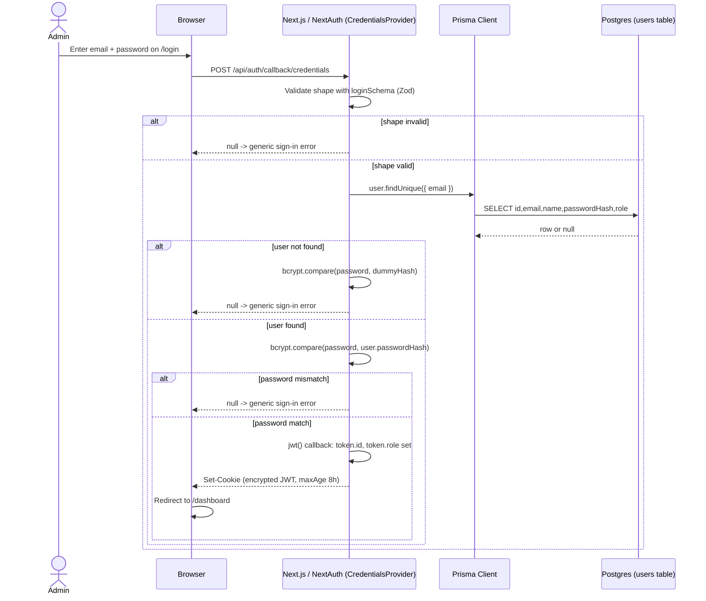
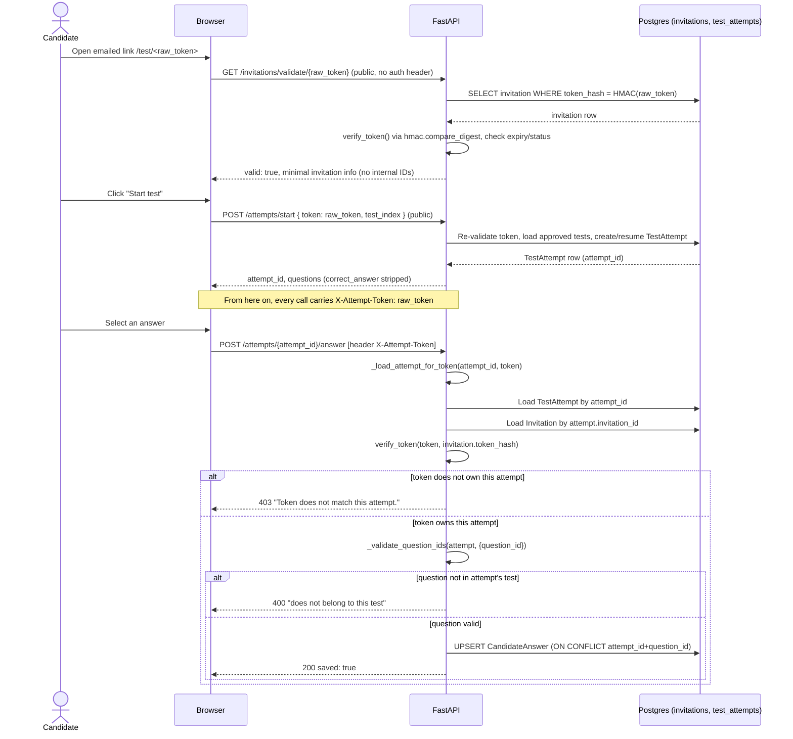
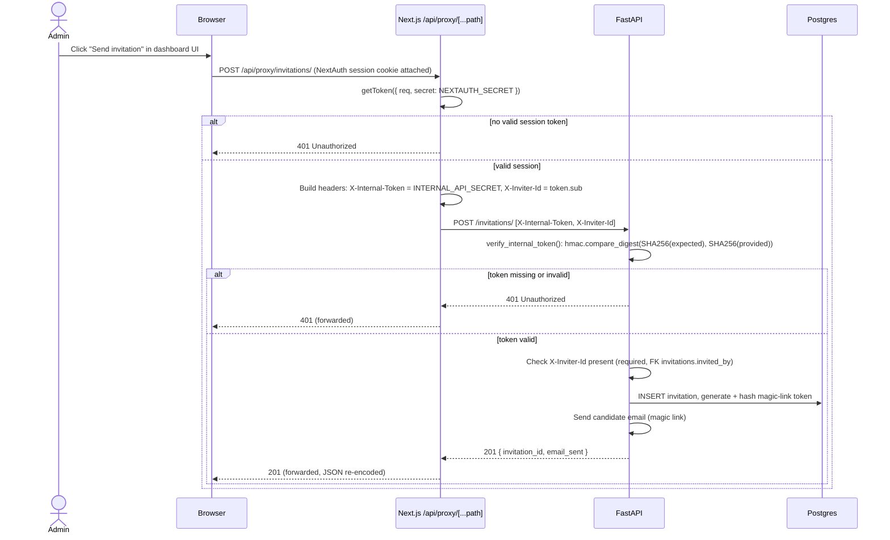

# 07 — Authentication & Authorization Architecture

> Audience: security reviewers, backend developers, future maintainers.
> Scope: this document describes the auth *mechanisms* as they exist in the
> current codebase, verified by reading the cited files line-by-line. It does
> not score risk or severity — that is the job of `11-security-audit.md`.
> Counts and cross-cutting facts are sourced from `_facts.md`; if anything
> here disagrees with that file, `_facts.md` wins.

## 0. The central fact: there are two independent auth systems

Talvyn has **no single auth system**. It has two, deliberately separate,
serving two different populations that never overlap:

| | Admin Auth | Candidate "Auth" |
|---|---|---|
| Who | Recruiters/HR staff (internal users) | Job candidates (external, one-off) |
| Mechanism | NextAuth Credentials provider, JWT session cookie | Magic-link token (HMAC-hashed, emailed) |
| Identity store | `users` table (Postgres, via Prisma) | `invitations` table — no candidate account exists |
| Where enforced | Next.js middleware + NextAuth session on every `/dashboard/*` route | FastAPI `_load_attempt_for_token` guard on every attempt-mutating call |
| Password / credential | bcrypt-hashed password | none — possession of the emailed link is the only credential |
| Registration | none (seeded), see §1.2 | none — an admin-created invitation is the only path in |

A third, narrower mechanism — the internal service token (§3) — exists so
the admin system can talk to FastAPI without putting a shared backend secret
in the browser. Treat all three as independent trust boundaries: a
vulnerability or fix in one says nothing about the other two.

---

## 1. Admin Authentication (NextAuth, JWT sessions)

Implemented entirely in `frontend/src/lib/auth.ts`, wired into Next.js via
`frontend/src/app/api/auth/[...nextauth]/route.ts`, and gated by
`frontend/src/middleware.ts`.

### 1.1 Login flow

The only provider configured is `CredentialsProvider` (email + password).
There is no OAuth, no SSO, no magic-link option for admins — credentials are
the sole path in.

`authorize()` in `auth.ts`:

1. Validates the submitted shape with a Zod schema before touching the
   database (`email` must be a valid email, `password` min 8 chars).
2. Looks up the user by lower-cased, trimmed email via Prisma
   (`prisma.user.findUnique`), selecting only `id, email, name, passwordHash, role`.
3. **If no user is found**, it still runs a bcrypt comparison against a
   hardcoded dummy hash before returning `null`:
   ```ts
   await bcrypt.compare(password, "$2b$10$invalidhashpaddingtoconstanttime");
   ```
   This exists specifically so that "user not found" and "wrong password"
   take the same amount of wall-clock time — a deliberate defense against
   timing-based user enumeration.
4. **If a user is found**, the real comparison is `bcrypt.compare(password, user.passwordHash)`.
   A `false` result returns `null` (NextAuth's generic "CredentialsSignin" error).
5. On success, returns a NextAuth `User` object carrying `id`, `email`,
   `name`, and the custom `role` field.

No endpoint distinguishes "no such user" from "wrong password" — both
collapse to NextAuth's generic sign-in failure.

### 1.2 No self-service registration — accounts are seeded

There is **no `/register` route, no sign-up form, and no admin-creation API
endpoint** reachable from the browser. The only ways an admin account comes
into existence are:

- **`frontend/prisma/seed.ts`** — runs automatically on every container
  start (per `_facts.md` §11) and idempotently creates a default admin:
  ```ts
  const SEED_ADMINS = [
    { email: 'acmeai@Talvyn.com', name: 'ACME AI Admin',
      password: 'acmeai@r2026p#', role: Role.ADMIN },
  ];
  ```
  It checks `prisma.user.findUnique({ where: { email } })` first and skips
  creation if the account already exists. The password is hashed with
  `bcrypt.hash(admin.password, 12)` before insertion — the plaintext literal
  in the seed file is never what's stored.
- **`create-admin.sh`** (repo root) — a manual CLI script for creating or
  resetting an admin outside the seed flow. Per `_facts.md` §11 this is
  "largely redundant now" given the seed script runs automatically, but it
  remains as an explicit manual override.

No code path lets an unauthenticated visitor create an admin account.
Provisioning additional admins is an operator action, not a product feature.

### 1.3 Password management

- **Hashing:** `bcryptjs`, via `bcrypt.hash(password, 12)` in `seed.ts` —
  cost factor **12**.
- **Comparison:** `bcrypt.compare(password, user.passwordHash)` in
  `auth.ts`'s `authorize()`, with the constant-time-shaped dummy-hash branch
  described in §1.1.
- There is no in-app "change password" or "forgot password" flow — password
  rotation is an operator-level action via the seed/CLI mechanisms above,
  not a self-service UI feature.

### 1.4 Session management

Configured directly in `authOptions`:

```ts
session: {
  strategy: "jwt",
  maxAge: 8 * 60 * 60, // 8 hours
},
```

- **Strategy:** `jwt` — no server-side session table; session state lives
  entirely in a signed/encrypted cookie. There is no DB session store to
  revoke, so a JWT remains valid until it expires (8 hours) or
  `NEXTAUTH_SECRET` is rotated — no server-side logout invalidation list.
- **`jwt` callback:** on sign-in, copies `user.id` → `token.id` and
  `user.role` → `token.role` into the encrypted token.
- **`session` callback:** surfaces `token.id`/`token.role` back onto
  `session.user`.
- **Secret:** `secret: process.env.NEXTAUTH_SECRET` — encrypts and signs
  the JWT.
- **Pages:** custom sign-in and error pages both point at `/login`.
- **Debug:** `debug: process.env.NODE_ENV === "development"` — verbose
  NextAuth logging is off in production builds.

### 1.5 Roles: ADMIN vs SUPER_ADMIN

The `Role` enum (`backend/app/db/models/enums.py`, mirrored in
`frontend/src/types/index.ts` as `UserRole = "ADMIN" | "SUPER_ADMIN"`) defines
two values. A grep across both `frontend/src` and `backend/app` for
`SUPER_ADMIN` turns up **only the two enum/type declarations themselves** —
no route guard, middleware check, conditional render, or service-layer
branch anywhere reads or compares against `SUPER_ADMIN`.

**Report honestly:** `SUPER_ADMIN` exists as a schema value but currently
has **zero functional distinction from `ADMIN`**. Any authenticated admin
has identical access regardless of which role value is stored on their row.
The field is carried through the JWT and exposed on the session, but
nothing reads it to make an authorization decision today.

### 1.6 Middleware protection

`frontend/src/middleware.ts` is Next.js Edge Middleware and is the sole
route-level gate for the admin app:

- `PUBLIC_PREFIXES = ["/test", "/api/auth", "/_next", "/favicon"]` always
  pass through unauthenticated — `/test/*` is the candidate-facing magic-link
  surface and must never require a session.
- Any path under `/dashboard` (`PROTECTED_PREFIX`) requires a valid token
  (checked via `getToken({ req, secret: NEXTAUTH_SECRET })`, decrypting and
  verifying the JWT cookie signature without hitting the database). If
  absent, the request redirects to `/login?callbackUrl=<original path>`.
- A visitor with a valid session hitting `/login` is redirected to
  `/dashboard` instead of seeing the form again.
- The matcher excludes Next static assets, images, and the favicon, so
  middleware runs on effectively every other request, including `/api/*`
  routes other than `/api/auth/*`.

This middleware enforces **authentication** (is there a session?), not
**authorization** (which role?) — consistent with §1.5, since there is
currently only one functional role tier to enforce.

---

## 2. Candidate "Authentication" (magic-link tokens, no accounts)

Implemented in `backend/app/core/security.py` (token primitives) and
`backend/app/services/attempt_service.py` (the per-call guards). There is
**no registration and no login for candidates** — the concept doesn't exist
in this system. A candidate's only credential is the URL they were emailed.

### 2.1 The magic-link model

When an admin sends an invitation (`POST /api/v1/invitations/`, behind
`VerifiedInternal`), the backend:

1. Generates a raw token with `secrets.token_urlsafe(32)` — 32 bytes of
   CSPRNG entropy, base64url-encoded to 43 characters.
2. Computes `hash_token(raw_token)` — an **HMAC-SHA256** digest keyed with
   `settings.magic_link_secret` — and stores only that hex digest as
   `invitations.token_hash`. The raw token is **never persisted**; it exists
   only in memory long enough to be emailed and to build the link
   (`build_magic_link()` → `https://.../test/<raw_token>`).
3. Emails the link to the candidate. From here, possession of that URL is
   the candidate's entire "session."

There is no password, no account record, and no candidate-facing login
form — receive email, click link, take test. Each token is scoped to one
candidate + one job description's approved test set (`invitations.jd_id`),
not to a generic account.

### 2.2 Token verification primitives

`backend/app/core/security.py`:

- `verify_token(raw_token, stored_hash)` recomputes the HMAC over the
  submitted token and compares it to the stored hash with
  `hmac.compare_digest()` — constant-time, so brute-forcing a token gains no
  timing signal.
- `is_expired(expires_at)` checks expiry (timezone-safe) against
  `magic_link_expiry_hours` from settings.
- Revoked (`InvitationStatus.REVOKED`) and expired invitations are both
  rejected in `start_attempt()` before any test content is returned.

### 2.3 The `_load_attempt_for_token` guard — preventing token replay across attempts

This is the security-critical chokepoint of the whole candidate flow.
`backend/app/services/attempt_service.py`:

```python
async def _load_attempt_for_token(
    attempt_id: str, token: str, db: AsyncSession
) -> TestAttempt:
    attempt = await _load_attempt(attempt_id, db)
    invitation = await _load_invitation_by_id(attempt.invitation_id, db)
    if invitation is None or not verify_token(token, invitation.token_hash):
        raise HTTPException(status_code=403, detail="Token does not match this attempt.")
    return attempt
```

It loads the `TestAttempt` by its `attempt_id`, then walks back to the
`Invitation` that owns it and verifies the caller's token hashes to *that
specific invitation's* stored hash. A token valid for invitation A cannot be
used to act on an attempt belonging to invitation B, even if the caller
knows or guesses B's `attempt_id`.

Per `_facts.md` §12, this guard runs as the **first operation** in every
mutating attempt-service function — `save_answer`, `bulk_save_answers`,
`heartbeat`, `submit_attempt`, `log_suspicious_event`, `get_attempt_state`.
An earlier third-party audit had flagged a "candidate attempt token
ownership bypass" as a P0 finding; reading the file line-by-line confirms
that finding is **false** — every mutation path is gated here before
touching `CandidateAnswer` or `TestAttempt` rows.

At the route level (`backend/app/api/v1/attempts.py`), the token arrives as
the `X-Attempt-Token` header (not a URL/query parameter) on every endpoint
except `/start`, enforced by the `_verify_attempt_token` dependency before
the request reaches the service layer. `/start` is intentionally public —
it's the only place a fresh token (just received via email) is exchanged for
an `attempt_id`.

### 2.4 The `_validate_question_ids` guard — preventing cross-test answer writes

A valid token for attempt A also must not let a candidate submit answers for
questions that don't belong to attempt A's assigned test:

```python
async def _validate_question_ids(
    attempt: TestAttempt, question_ids: set[str], db: AsyncSession
) -> None:
    result = await db.execute(
        select(Question.id).where(
            Question.test_id == attempt.test_id,
            Question.id.in_(question_ids),
        )
    )
    valid_ids = {row[0] for row in result.all()}
    if valid_ids != question_ids:
        raise HTTPException(status_code=400, detail="One or more questions do not belong to this test.")
```

This runs inside `save_answer` and `_bulk_save_answers_for_attempt` (shared
by `bulk_save_answers` and `submit_attempt`'s final-answers snapshot) — every
code path that writes a `CandidateAnswer` row. It closes a distinct attack
from §2.3: even with a correctly-owned token, a candidate cannot smuggle in
answers for question IDs belonging to a different test.

### 2.5 Other invariants worth naming

- **Correct answers never leave the service.** `_safe_question()` strips
  `correct_answer`, `explanation`, `expected_answer`, `scoring_rubric`, and
  per-option `is_correct` flags before any question reaches the candidate.
  MCQ options are shuffled per-attempt (seeded on `attempt_id + question_id`)
  so option position can't be memorized or shared across candidates.
- **Submission is idempotent.** `submit_attempt` checks
  `attempt.status == AttemptStatus.SUBMITTED` first and returns the existing
  result rather than double-processing a retried request.
- **The exam timer is server-authoritative.** `heartbeat` recomputes
  remaining time from `started_at + duration` and only accepts the
  client-reported value within a 30-second tolerance; otherwise it overrides
  with the server's value and can force a submit. The client timer is
  advisory UX only.
- **`POST /attempts/start` and `GET /invitations/validate/{token}` are the
  only intentionally public, unauthenticated backend endpoints** (besides
  `/health`) — exactly where an unauthenticated candidate, holding nothing
  but the emailed link, must be able to enter the system.

### 2.6 This is a deliberate tradeoff, not an oversight

The absence of candidate accounts, passwords, or a login screen is a
**product decision**, not a missing feature: candidates are one-time,
external participants in a hiring process, and the design goal is a
frictionless, single-click experience. The tradeoffs this implies — a
leaked or forwarded link grants access to anyone holding it; there's no MFA;
expiry and revocation are the only post-issuance controls — are the
documented cost of that choice, enforced by the guards above rather than
left unmitigated. Severity judgment on this tradeoff belongs to
`11-security-audit.md`.

---

## 3. Internal Service-to-Service Token (X-Internal-Token)

The Next.js server and the FastAPI backend are two separate processes/
containers. Most FastAPI endpoints must only ever be called by the
Next.js server on behalf of an authenticated admin — never directly by a
browser. `X-Internal-Token` is the mechanism that enforces that boundary.

### 3.1 Why it exists

`INTERNAL_API_SECRET` is a shared secret known to both the Next.js
server process and FastAPI (set in `backend/.env.example` and
`frontend/.env.local.example`, per `_facts.md` §10). It must **never reach
the browser** — if it did, any client could call FastAPI's admin endpoints
directly, bypassing NextAuth entirely. The architecture keeps it
server-side-only:

- Browser-side admin components call `/api/proxy/[...path]` (a Next.js
  server route, `frontend/src/app/api/proxy/[...path]/route.ts`), never
  FastAPI directly.
- The proxy route runs entirely on the Next.js server (Node runtime), reads
  `process.env.INTERNAL_API_SECRET`, and attaches it as the
  `X-Internal-Token` header on the outgoing request to FastAPI. The browser
  never sees this value — it only ever talks to the proxy's own origin.

### 3.2 How the proxy authenticates the admin first

Before forwarding anything, the proxy itself checks the caller's NextAuth
session:

```ts
const token = await getToken({ req, secret: process.env.NEXTAUTH_SECRET });
if (!token?.sub) {
  return NextResponse.json({ error: { code: "UNAUTHORIZED", ... } }, { status: 401 });
}
```

Per the comment in that file (a documented P1-4 optimisation), `getToken()`
is used instead of `getServerSession(authOptions)` because it skips the
`jwt`/`session` callbacks — relevant on high-frequency paths (autosave,
heartbeat polling). It still performs a real cryptographic verification of
the JWT cookie signature; it only skips unnecessary callback work.

Once the session is confirmed, the proxy forwards two things: the
`X-Internal-Token` (the `INTERNAL_API_SECRET` value, proving this call
originated from the trusted Next.js server) and `X-Uploader-Id` /
`X-Inviter-Id` (set to `token.sub`, the authenticated admin's database user
ID) so FastAPI can attribute ownership (e.g. `invitations.invited_by`) and
apply per-user rate limiting (§5) without ever needing to validate a
NextAuth JWT itself.

### 3.3 How FastAPI verifies it — `verify_internal_token`

`backend/app/dependencies.py`:

```python
async def verify_internal_token(
    x_internal_token: Annotated[str | None, Header()] = None,
    settings: Settings = Depends(get_settings),
) -> None:
    if x_internal_token is None:
        raise HTTPException(status_code=401, detail="Missing X-Internal-Token header")

    expected = settings.internal_api_secret.encode()
    provided = x_internal_token.encode()

    if not hmac.compare_digest(
        hashlib.sha256(expected).digest(),
        hashlib.sha256(provided).digest(),
    ):
        logger.warning("Invalid internal token attempt")
        raise HTTPException(status_code=401, detail="Invalid internal token")
```

The comparison hashes both sides with SHA-256 first, then compares the two
digests with `hmac.compare_digest()` — constant-time, so an attacker
fuzzing the header gains no timing signal. The function is exposed as the
`VerifiedInternal` type alias (`Annotated[None, Depends(verify_internal_token)]`)
and used as a required dependency on essentially every admin-facing route
(e.g. every non-public endpoint in `invitations.py`: `create_invitation`,
`list_invitations`, `resend`, `revoke`, `get_invitation`).

The dependencies module documents the scope of this control honestly:
*"This is NOT a substitute for proper auth — it's a lightweight layer
ensuring only the Next.js server can call FastAPI directly."* It proves the
request came from the trusted server process, not that a specific admin is
authorized for the action — that finer-grained identity travels separately
via `X-Uploader-Id`/`X-Inviter-Id`, sourced from the already-verified
NextAuth JWT in the proxy.

### 3.4 Candidate routes are the deliberate exception

`backend/app/api/v1/attempts.py` endpoints (other than the public `/start`)
require `X-Attempt-Token`, **not** `X-Internal-Token` — by design, per the
module docstring: *"These endpoints have NO X-Internal-Token requirement
because they are called directly from the candidate browser (no Next.js
server in between)."* Candidates never go through the Next.js proxy for
attempt mutations; their browser calls FastAPI directly, authenticated only
by the magic-link token described in §2.

---

## 4. Roles & Permissions

| Capability | Admin (ADMIN/SUPER_ADMIN) | Candidate |
|---|---|---|
| View/manage dashboard, JDs, tests, invitations, results, leaderboard | Yes — gated by NextAuth session via `middleware.ts` and `VerifiedInternal` on every backing FastAPI call | No — `/dashboard/*` is unreachable without a valid JWT cookie |
| Create/send/resend/revoke invitations | Yes (`VerifiedInternal`) | No |
| Upload/analyze JDs, generate/edit/approve tests | Yes (`VerifiedInternal`) | No |
| Trigger/view AI evaluations, export results | Yes (`VerifiedInternal`) | No — candidates never see scoring, rubrics, or other candidates' results |
| Validate a magic link, start a test attempt | N/A | Yes — the only two public, unauthenticated backend endpoints besides `/health` |
| Save answers, heartbeat, submit, log integrity events for **their own** attempt | N/A | Yes — gated per-call by `_load_attempt_for_token` (§2.3) |
| Act on an attempt that isn't theirs | No | No — rejected 403 by `_load_attempt_for_token` regardless of role |
| Distinguish ADMIN vs SUPER_ADMIN behavior | None implemented (§1.5) | N/A |

Enforcement is **route/dependency-level in both systems**, not UI hiding:
Next.js middleware blocks unauthenticated `/dashboard/*` requests before a
page renders, FastAPI's `VerifiedInternal`/`AttemptToken` dependencies
reject unauthorized requests before any service function runs, and
`_load_attempt_for_token` / `_validate_question_ids` reject cross-attempt
and cross-test access at the data-access layer itself.

---

## 5. Security Controls Summary

Concrete, independently verifiable controls currently in place:

- **Backend input validation:** every FastAPI request body is a Pydantic
  `BaseModel` (72 occurrences across the 7 files in `backend/app/schemas/`)
  — validation runs before any handler logic.
- **Frontend input validation:** Zod schemas guard form input at the edge —
  confirmed in `frontend/src/components/admin/InviteForm.tsx` and
  `frontend/src/app/(auth)/login/page.tsx` (the login schema is duplicated
  client- and server-side; §1.1 covers the server-side copy in `auth.ts`).
- **Secrets are not committed.** Per `_facts.md` §12, re-verified via
  `git ls-files`: only `.env.example` (root), `backend/.env.example`, and
  `frontend/.env.local.example` are tracked. `.env`, `frontend/.env`, and
  `backend/.env.hardware` are gitignored. An earlier audit's claim that
  `.env` files were tracked was checked against the current repo and found
  false.
- **Rate limiting:** `slowapi` + Redis (`backend/app/core/ratelimit.py`),
  enforced globally across all 4 uvicorn workers via Redis-backed storage
  rather than per-process counters. Keyed by `X-Uploader-Id` when present
  (per-admin, not per-IP — every request to FastAPI otherwise shares the
  Next.js container's IP), falling back to client IP. Applied to exactly 4
  Ollama-backed endpoints: `POST /jd/upload` (10/min),
  `POST /jd/{id}/analyze` (5/min), `POST /tests/generate/{jd_id}` (3/min),
  `POST /evaluation/trigger` (5/min).
- **Constant-time comparisons** in three independent places: candidate
  token verification (`hmac.compare_digest` in `core/security.py`), internal
  token verification (`hmac.compare_digest` over SHA-256 digests in
  `dependencies.py`), and the dummy-bcrypt-compare branch for non-existent
  admin users (`auth.ts`) — each closes a timing side-channel in its system.
- **Security headers** (`frontend/next.config.ts`, applied to all routes):
  `X-Frame-Options: DENY`, `X-Content-Type-Options: nosniff`,
  `Referrer-Policy: strict-origin-when-cross-origin`,
  `Permissions-Policy: camera=(), microphone=(), geolocation=()`. This is
  the complete list as configured — no CSP, HSTS, or `X-XSS-Protection`
  header is set (severity judgment belongs to `11-security-audit.md`).
- **Token storage discipline:** magic-link tokens are never stored raw
  (only their HMAC-SHA256 hash, §2.1); internal/session secrets
  (`INTERNAL_API_SECRET`, `NEXTAUTH_SECRET`) live only in server-side env
  vars, never sent to or readable by the browser.
- **Reverse-proxy isolation:** `api/proxy/[...path]/route.ts` is the only
  place `INTERNAL_API_SECRET` is read and attached.

---

## 6. Sequence Diagrams

### 6.1 Admin login flow (NextAuth, JWT session)



### 6.2 Candidate magic-link redemption + first attempt mutation



### 6.3 Authenticated admin action via the X-Internal-Token proxy hop



---

## 7. Highgarden Analytics Privacy

Highgarden is Talvyn's first-party behavior analytics surface for
`SUPER_ADMIN` users. Access requires both the normal admin session and the
separate Highgarden unlock cookie, so raw analytics pages and CSV exports are
not available to ordinary admins or users.

Highgarden stores operational behavior signals only:

- page path without query strings or URL fragments
- click label and selector after server-side redaction
- normalized click percentages for click/dead-click heatmaps
- coarse device/browser/OS/country metadata
- bounded safe metadata such as workflow area and page title
- optional feedback rating/category/comment after comment sanitization

Highgarden deliberately does not store:

- IP addresses
- form values
- passwords, tokens, passphrases, or secret-like values
- candidate answers
- uploaded document text, file contents, resumes, or CV text
- raw screenshots or DOM snapshots
- URL query strings or fragments

The client tracker uses a blocked selector list for sensitive controls:
`input`, `textarea`, `select`, contenteditable/rich-text editors, password,
email, phone, token-like fields, file inputs, and candidate answer areas. Any
element can opt out explicitly with `data-hg-ignore`; `data-no-track` is also
treated as an alias for compatibility.

The `/api/track` ingestion route treats analytics as best-effort and fails
closed with `204` responses. It re-sanitizes posted paths, labels, selectors,
referrers, and metadata before writing to Postgres, and only stores click
coordinates for `CLICK` and `DEAD_CLICK` events. Cloudflare's `cf-ipcountry`
header may be stored as a two-letter country code; the IP address itself is
not stored.

Raw event retention remains 90 days by default. The Highgarden overview keeps
a gated retention purge and also provides manual purge controls by event type
and date range for targeted cleanup.

---

## 8. Summary

Talvyn's auth surface is small but deliberately partitioned: NextAuth JWT
sessions gate the admin app behind a single password credential with no
self-service registration; magic-link tokens give candidates frictionless,
account-free access scoped tightly to one invitation via the
`_load_attempt_for_token` / `_validate_question_ids` guards; and a
constant-time-compared internal secret keeps `INTERNAL_API_SECRET` and every
FastAPI admin route unreachable from outside the Next.js server. Each
mechanism is independently simple — reason about each on its own terms
rather than assuming a control in one implies anything about the others.
